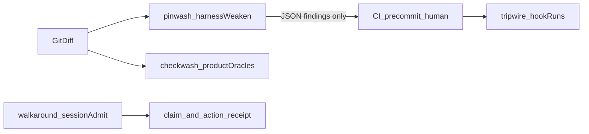
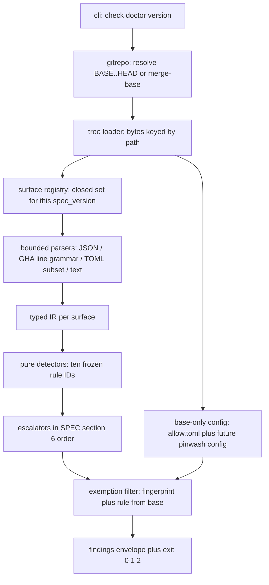
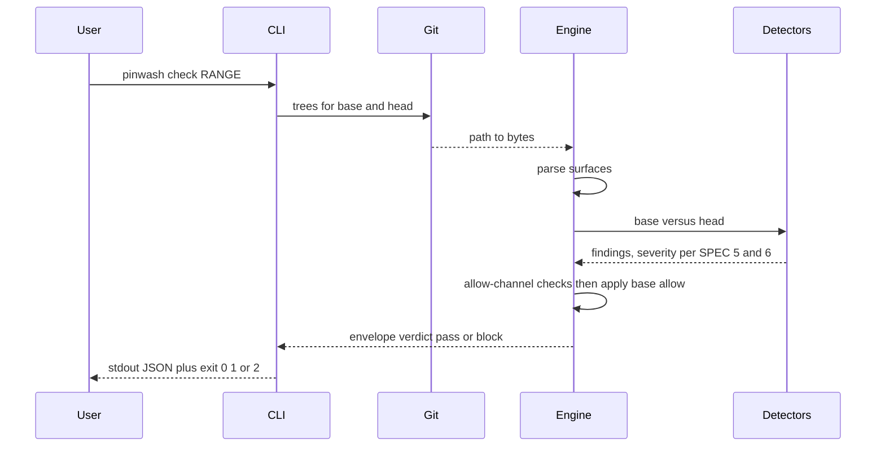

# pinwash architecture

**North star:** on a pair of git trees (`base` / `head`), using a closed surface set and a closed rule-ID set, flag harness weakenings that make an agent more able to claim done. The verdict is replayable: no network, no LLM, no subject execution.

This file explains layers and evolution. It does **not** add rules, surfaces, exit codes, or acceptance criteria.

**Conflict rule:** [SPEC.md](SPEC.md) wins. [THREATMODEL.md](THREATMODEL.md) owns residual rows. Frozen acceptance is [tests/gates/test_v0_acceptance.py](tests/gates/test_v0_acceptance.py). Coding agents have read-only authority over `tests/gates/**`. SPEC rulings and edits are delegated to the maintaining agent (SPEC preamble, 2026-09-27): each one bumps the spec version, lands as its own commit, and re-runs the fixture suite. If this file disagrees with SPEC, SPEC is correct and this file is wrong.

SPEC's opening records the local engine and the 2026-09-27 delegated edit authority. This checkout has a **local v0 engine** at `0.0.0` / spec `16` (each bump is its own commit with a changelog entry in SPEC §16). That is not a Release, not PyPI, and not a 1.0 claim.

## 0. What this product is allowed to be

pinwash is a static, local, deterministic **diff scanner**. It judges **harness weakening**, not product tests, not claims, not journeys, not whether a hook actually ran.

It never emits `SECURE`, `HARNESS_INTACT`, `HONEST`, `COMPLETE`, or `ENFORCED`. The strongest valid pass sentence is SPEC §0:

> No in-scope weakening finding at or above `fail_on` was observed on this base/head pair, under this spec version, surface set, and pinwash revision.

A1–A11 holding does **not** license a public 1.0 (SPEC §12).

## 1. Neighbours (do not reimplement)



| Product | Question pinwash does not answer |
|---|---|
| checkwash | Did this diff weaken product tests / CI oracles? |
| walkaround / action-receipt / claim-receipt-lab | Did the agent enter a contract or emit a receipt for a done-claim? |
| phaseledger | Did a measurer allow a phase advance? |
| charterlock | Was the journey allowed to be the exam? |
| tripwire | Is a hook actually executing a pinned judge on this host? |
| boundkit | Was the task claimed and authorized? |
| smallestlie | What lie does this verifier still accept? |

On one diff, checkwash may emit a guardrail-touch event and pinwash may emit a structured weakening. Identities must not be shared. A hook runner may **invoke** pinwash; enforcement belongs to that runner. pinwash does not install, invoke, or trust hooks.

Of the neighbour products in this diagram and table (pinwash itself aside), only checkwash and smallestlie remain on GitHub. walkaround, action-receipt, claim-receipt-lab, phaseledger, charterlock, tripwire, and boundkit were removed on 2026-09-26; they are named only to bound pinwash's scope, not as live integrations.

## 2. Trust boundaries (invariants)

1. The **head** tree — including the working tree — is attacker-controlled. Agents write it. In hook and worktree mode that includes the repository's own `.git`: its config, refs, hooks, `info/` files and object store.
2. **Configuration and allowlists are read from the base side only.** A head-side disable does not govern the run that reviews that head. Creating a base-absent config that relaxes defaults is itself a finding (`CONFIG_RELAXED`).
3. The core path **reads bytes**. It never executes subject code, hooks, judges, workflows, MCP servers, or skills, nor a program the subject repository's git configuration names. It never uses a network. It never calls a model.
4. GitHub rulesets that exist only on an API and not as a file in the trees are residual R05: `UNKNOWN`, not pass and not block.
5. The analysis unit is a **diff** (`base`/`head`). pinwash never judges a single snapshot as “the harness is fine”.
6. Missing observation is never a pass: unobservable inputs surface as `SURFACE_UNPARSEABLE` findings, `config_errors` entries, or `unknown_coverage` rows. A crashed engine is exit **2**, never a block (exit 1). Subject-surface parse failure is `SURFACE_UNPARSEABLE`, not exit 2, unless git itself cannot be read.
7. Artifacts the agent wrote in the same diff (logs, screenshots, “CI is green” prose) are never evidence that a harness still runs.

**Git hardening (H0, 2026-10-09; engine only, no spec bump).** Items 1 and 3 hold for git itself: every git call runs as `git --no-replace-objects -c core.fsmonitor=false -c core.commitGraph=false -c core.untrackedCache=false -c core.hooksPath=<no file>` (and, since spec 16, `-c core.ignoreCase=false`) with `GIT_NO_LAZY_FETCH=1`, `GIT_ALLOW_PROTOCOL=` (empty), `GIT_GRAFT_FILE` and `GIT_SHALLOW_FILE` naming no file, and stdin from the null device. Command-line `-c` outranks every config file, `include.path` and `includeIf` targets and `config.worktree` included. Every commit, tag, tree and blob read from the object store is rehashed against its id (SHA-1 or SHA-256 by `rev-parse --show-object-format`); a commit's tree id comes from its verified body, never from a commit-graph or a `^{tree}` shortcut; tree listings are parsed from verified tree objects; a mismatch is an unreadable git tree, exit 2, never a pass. `BASE...HEAD`'s merge base is computed from verified commit objects with git's algorithm (`paint_down_to_common` and `remove_redundant`, the same queue order, committer dates read as git's `parse_commit_date` reads them); `git merge-base` is not asked. Commits are read ahead in batches (`git rev-list` from the walk's frontier, piped into one `cat-file --batch --buffer`); that listing is a hint, and only objects that rehash are kept. A missing object is exit 2 that names it. A tree that lists one name twice or breaks git's entry order (git fsck's duplicateEntries / treeNotSorted) is malformed, exit 2: git itself reads it two ways (ls-tree -r lists both entries, diff-tree takes the first), and reading the last one let a committed Stop removal pass `BASE..HEAD` (second H0 review). The work tree must be the directory holding the `.git` that git found, or, with `GIT_DIR` set, the cwd (git's default there), unless the judge sets `GIT_WORK_TREE`. Vectors, each tried on git 2.43.0 (this host's Ubuntu build), with the spec 12 engine and now:

| Subject writes | spec 12 engine | Now |
|---|---|---|
| `core.fsmonitor` (directly, through `include.path`, `includeIf` or `config.worktree`) | `ls-files` ran the program (plain check, `BASE..WORKTREE`) | `-c core.fsmonitor=false` |
| promisor remote (`extensions.partialClone`) plus a deleted BASE object: `ext::` URL, a local URL with `remote.*.uploadpack`, `ssh://` with `core.sshCommand`, a `<helper>::` URL | lazy fetch ran the program; an `ext::` program that served the genuine blob while it flipped the worktree passed | no lazy fetch (where git knows `GIT_NO_LAZY_FETCH`) and no transport on any version (`GIT_ALLOW_PROTOCOL=`); the missing object is exit 2 |
| `refs/replace/*` (`git replace`, `git replace --graft`) | BASE blob, commit or parents substituted: pass | `--no-replace-objects` |
| a loose object, pack index or alternate store that maps an id to other bytes | a forged BASE blob or tree was read: pass (a forged commit named by the range failed git's own check: exit 2) | rehash: exit 2 |
| a forged commit object below HEAD that steers `git merge-base` | older base: pass | the walk reads it, the rehash fails: exit 2 (a read-ahead batch drops it first) |
| `info/grafts`, `.git/shallow`, `objects/info/commit-graph` parents | `BASE...HEAD` moved to an older base: pass (grafts and the graph also moved `HEAD~n`) | none is read (`GIT_GRAFT_FILE`, `GIT_SHALLOW_FILE`, `core.commitGraph=false`); parents come from verified commits; a deleted commit gives the full history's merge base or exit 2 |
| `core.worktree = ../..` (with or without the judge's `GIT_DIR`) | both trees listed as a subtree that does not exist: every range and the plain check passed | exit 2 |
| `core.worktree` elsewhere, `core.bare = true`, an unknown `extensions.*`, a repository owned by another user (git ignores `safe.directory` in repository config) | exit 2 | exit 2 |
| a `.git` file (`gitdir:`), the submodule layout, a linked worktree; a judge's `GIT_DIR` with the cwd as the work tree (hooks, yadm, vcsh) | judged | judged; base bytes are rehashed wherever the store lives |
| every hook name in `.git/hooks` and `core.hooksPath` (`reference-transaction`, `post-index-change` included); clean / smudge / process filters, textconv, diff and merge drivers, `core.pager` and `pager.*`, `core.askPass`, `credential.helper`, `gpg.program`, editors, `core.alternateRefsCommand`, `diff.external` | never ran: the plumbing pinwash calls (`rev-parse`, `rev-list`, `cat-file`, `ls-files`, and `merge-base` and `ls-tree` in spec 12) runs none of them, and stdout is a pipe (no pager) | unchanged; `core.hooksPath` also names no directory |
| `core.ignoreCase = true` plus a case-variant decoy in the index (`.cursor/MCP.json`, deleted on disk), on a case-sensitive filesystem | `ls-files` matched a new `.cursor/mcp.json` to the decoy, so the worktree read never saw it: plain check and `BASE..WORKTREE` passed | `-c core.ignoreCase=false` (spec 16, second review of 2026-10-10) |
| `core.untrackedCache`, `trace2.*` | not read (`ls-files` never reads the untracked cache; trace2 reads system and global config only) | unchanged; `core.untrackedCache=false` as defence in depth |

What is left open, the consumer-visible changes and the cost are in §10 (H0).

The only clock that may affect a verdict is the exemption window on `.pinwash/allow.toml` (expiry, the spec 11 in-force start, and the spec 11 check for added records whose `created` is after today), overridable with `PINWASH_TODAY` for replay.

Range notation matches checkwash: `BASE..HEAD` is tree-to-tree; `BASE...HEAD` is `merge-base(BASE, HEAD)..HEAD` and must not silently become two-dot. Paths use forward slashes. Comparison text is CRLF→LF before parse.

## 3. Runtime layers

### 3.1 Target shape (1.0 module layout; the split landed in afec809)

Adding a surface must be: spec bump + one registry row + one parser + one detector. Not another loop in a thousand-line engine.



The module split landed in afec809 (behaviour-preserving, no spec bump):

- `pinwash/parse/` — `gha`, JSON surfaces, TOML subset, hook command strings
- `pinwash/rules/` — one module per rule family
- `pinwash/escalate.py` — `SEVERITY_RANK` and the SPEC §6.1–6.3 predicates
- `pinwash/allow.py` — base `.pinwash/allow.toml`
- `pinwash/engine.py` — orchestration only

Still short of this shape: the typed IR (§3.2), severity set where findings are emitted rather than in one escalator stage, and `allow.toml` in the surface `EXACT` set (§10).

Public JSON fields and the fingerprint formula stay frozen in SPEC §7. A refactor that changes fingerprint semantics is a spec bug.

### 3.2 What this checkout actually has

| Layer | Duty | Code today |
|---|---|---|
| CLI | Dispatch; unexpected exceptions → exit 2 | `pinwash/cli.py` |
| Git adapter | Two-dot / three-dot; tree bytes (blobs only: a gitlink is no file, b5c7551); a worktree file the engine cannot read counts as non-UTF-8 bytes (f849b8a); unreadable git → `GitError`. Hardened against the subject's `.git` (§2): every call `--no-replace-objects`, fsmonitor and commit-graph off, no grafts, shallow, hooks, lazy fetch or transport; every object rehashed against its id, trees parsed from verified objects, the `BASE...HEAD` merge base computed from verified commits; the work tree must hold its `.git` | `pinwash/gitrepo.py` |
| Surface registry | Path → membership in the v0 closed set | `pinwash/surfaces.py` |
| Bounded parsers | Not YAML 1.2, not full TOML, JSON read the same at any depth and integer length (§5), closed hook-command resolution | `pinwash/parse/` (`gha`, `jsonsurf`, `tomlsub`, `hookcmd`) |
| Typed IR | Detectors must not see raw YAML | **Missing** — 1.0-shape gap |
| Detectors | Pure, no I/O; one module per rule family | `pinwash/rules/` |
| Escalators | SPEC §6 order; no scores | `pinwash/escalate.py` holds the SPEC §6.1–6.3 predicates; every other severity is set where its finding is emitted (§10) |
| Allow | Fingerprint + rule; never a rule-glob | `pinwash/allow.py` |
| Envelope | Stable sort keys; no clock; no floats | `pinwash/findings.py` |

`engine.py` is orchestration only: surface dispatch, the §3 unparseable table, and assembly.

## 4. Data flow



- `pinwash check` with no range: `HEAD` versus worktree. Worktree is the attack surface (tracked and untracked, `--exclude-standard`).
- Default `fail_on` is `high`. `warn` does not fail the run (A6: phrase hit on skill markdown is warn, exit 0). `PERMISSION_WIDENED` and `CONFIG_RELAXED` escalate to **high** (`CONFIG_RELAXED` at `.pinwash/allow.toml` is **critical**, SPEC §10); `EXEMPTION_ADDED` is **critical** when an added record's `created` is after today (spec 11). Last remaining Stop-like hook, last remaining required context, or last non-floating pin on a workflow (when floated) escalate per SPEC §6.
- stdout JSON is the **only machine API**: UTF-8, sorted keys, `ensure_ascii=False`, newline `\n`. Human reports may degrade glyphs; machine JSON may not. A lone surrogate in a value (a non-UTF-8 path name decoded with `surrogateescape`, a JSON `\udXXX` escape) is written as a `\udXXX` escape inside its string, which loads back to the same value, and is fingerprinted through `surrogatepass`; every other string encodes and hashes as before (0ddcd57). It used to crash to exit 2.
- `unknown_coverage` does not change `verdict`, and a row never adds, drops or changes a finding. Its `reason` is fixed text from the closed list in SPEC §7 (spec 13; spec 14 added the workflow rows): the §3.1 grammar hits, the hook-side rows of SPEC §3.3 and §5.1, and the required-check producer rows of SPEC §5.5. A consumer that requires “no unknown coverage” is **consumer policy**, not this spec.
- `pinwash_findings_version` is `1`. `spec_version` tracks SPEC §16 (currently `16`). `pinwash_version` is `0.0.0`.

## 5. Surfaces, parsers, detectors (v0 closed set)

Adding a surface or a rule ID is a spec bump. v0 rule IDs (and no others in the `rule` field):

`HOOK_REMOVED` · `HOOK_BYPASSED` · `GATE_STUBBED` · `JUDGE_UNPINNED` · `PERMISSION_WIDENED` · `SKILL_BYPASS` · `REQUIRED_CHECK_DROPPED` · `CONFIG_RELAXED` · `EXEMPTION_ADDED` · `SURFACE_UNPARSEABLE`

Internal helper names must not appear in JSON `rule`.

| Surface ID | Paths | Parse | Detectors |
|---|---|---|---|
| `claude_settings` | `.claude/settings.json`, `.claude/settings.local.json` | JSON object | hook trio; `PERMISSION_WIDENED`; hook-side `unknown_coverage` rows (spec 13: `rules/hook_coverage.py`, `rules/hook_selector.py`, the liveness row in `rules/hook_rules.py`) |
| `claude_hooks` | `.claude/hooks/**` plus §3.3-resolved command targets (restored in spec 4) | JSON if `.json`, else command string | parse status; §5.2 closed-set body stubs feed `GATE_STUBBED` and the last-Stop escalator |
| `cursor_hooks` | `.cursor/hooks.json` | JSON object | hook trio; hook-side `unknown_coverage` rows (spec 13), `disableAllHooks` excepted |
| `cursor_mcp` | `.cursor/mcp.json`, `.mcp.json` | JSON object | `PERMISSION_WIDENED` |
| `agent_markdown` | `AGENTS.md`, `CLAUDE.md`, `GEMINI.md`, `QWEN.md`, `.cursorrules`, `.windsurfrules`, `.clinerules`, `.github/copilot-instructions.md`, `.cursor/rules/**/*.mdc`, `.cursor/rules/**/*.md` | UTF-8 text | `SKILL_BYPASS` only |
| `skill_md` | `**/SKILL.md` and the two skill trees named in SPEC §3 | UTF-8 text | `SKILL_BYPASS` only |
| `gha_workflow` | `.github/workflows/*.{yml,yaml}` | bounded line grammar, not YAML 1.2 | job drop / `if: false` / `continue-on-error` / `on:` trigger-loss (spec 8) — job side fires only for jobs producing a base-named ruleset context (SPEC §5); workflow-side `unknown_coverage` rows (spec 14: the §3.1 grammar rows in `parse/gha.py`, the SPEC §5.5 producer rows in `rules/required_check.py`) |
| `action_pin` | same workflow files | `uses:` lines in that grammar | `JUDGE_UNPINNED` |
| `gha_ruleset` | `.github/required-ruleset.json`, `.github/rulesets/*.json` | JSON object | `REQUIRED_CHECK_DROPPED` |
| `declared_pins` | `.pinwash/pins.json` (optional) | JSON array of pin records | `JUDGE_UNPINNED` |
| `checkwash_config` | `.checkwash/config.toml`, `.greenwash/config.toml` | bounded TOML subset | `CONFIG_RELAXED` |
| `gemini_settings` | `.gemini/settings.json` | JSON object | `PERMISSION_WIDENED` (`autoAccept`, `approvalMode`, mcp `trust`) |
| `opencode_config` | `opencode.json` | JSON object | `PERMISSION_WIDENED` (`permission.<tool>` lattice) |

Files outside these paths are invisible to v0. A harness that lives only in `$HOME`, a SaaS UI, or a gitignored local settings file is residual R02.

`.pinwash/allow.toml` is the **exemption channel**, not a §3 surface. Today `pinwash/surfaces.py` lists it in `EXACT` so the tree loader keeps the bytes. Architecturally it is config, not a detection surface. Head-side additions never govern the current run, which still trusts **base**; they surface as `EXEMPTION_ADDED` (critical when an added record's `created` is after today, SPEC §10).

`SKILL_BYPASS` compares **added or edited lines** (not deletions) against the closed phrase table in SPEC §5.4. Documentation of those phrases in `SPEC.md` / `THREATMODEL.md` / `README.md` is excluded by path. **This file is not in that exclude set.** Do not paste the phrase table here. Extra exclude globs are a spec bump. The exclusion covers phrase matching only: the SPEC §3 parse-status check runs first, so an excluded `agent_markdown` file such as `.cursor/rules/x/README.md` that stops decoding is still `SURFACE_UNPARSEABLE` (5794e5c).

If a surface file existed at base and is unparseable at head under that surface’s parse: `SURFACE_UNPARSEABLE` high. Unparseable on both sides: warn.

JSON surfaces parse the same at any nesting depth and any integer length (0ddcd57). A document nested up to 128 levels (a linear bracket pre-scan outside strings decides) goes to `json.loads` as before; a deeper one goes to an iterative reader of the same grammar, which tests hold to `json.loads` on generated and real documents. The hook and ruleset walkers keep their own stack. Before, `json.loads` raised `RecursionError` from about 990 levels on 3.11 (fewer under a deeper caller stack) and about 10000 on 3.12/3.13, the walkers recursed again over what did parse (a ruleset failed just below 1000 levels on every interpreter), and the CLI exited 2, so between those depths the interpreters disagreed. Integer literals up to 4300 digits (CPython's default `int_max_str_digits`) convert to the same `int` as before without consulting the process limit, so `PYTHONINTMAXSTRDIGITS` cannot change a result; a longer literal, which `json.loads` refused, is kept as an exact `decimal.Decimal` (no rule reads JSON numbers). Every document the engine judged before is judged the same, and the ones it crashed on are judged on all three interpreters. A JSON surface is `unparseable` only for a syntax error or bytes that are not UTF-8. Open for a ruling (§10): SPEC §3's table emits nothing for a surface absent at base and unparseable at head (booked as SPEC §11 R19 in spec 12), while §3.2 says a checkwash config that is not UTF-8 is `SURFACE_UNPARSEABLE` with no base-side condition.

### 5.1 Bounded GHA grammar (v0)

After CRLF→LF: drop comment lines; spaces-only indent (SPEC §3.1 states the tab rule since spec 12: a tab before a line's first `#`, or anywhere on a line without one, fails the whole file); record `uses:`, `continue-on-error:`, `if:`, job keys (exactly two spaces under `jobs:`), and job `name:` under the stack in SPEC §3.1, plus (spec 8) the triggers of a column-0 `on:`: inline scalar, inline `[a, b]`, and indent-2 block list items or mapping keys. Every recorded value is truncated at the first ` #` (spec 5). Spec 14 records, as text the SPEC §5.5 rows compare and never evaluate, the configuration lines of `push` / `pull_request`, and at job indent `needs:`, `strategy:`, a job-level `uses:`, a multiline job `if:` as its lines, and the step run keys (`if`, `continue-on-error`, `shell` inside the job's `steps:` / `defaults:` blocks and the workflow's column-0 `defaults:`, a `- ` item at job indent included, never under a step's `with:` or `env:` or inside a script body; each with its step's identity, and flow-style values as text); a column-0 line ends the job table. Since the spec 14 reviews the job-table grammar rows are reported only while a base ruleset names a context, for a changed file or a partly read job table while another callable workflow changes; `workflow layout unresolved` reports document forms the grammar does not read (a byte order mark, NEL / LS / PS line breaks, an indented document, a second document, and keys behind a tag, anchor or `?`); quoted scalars left open on their line, and flow values left open, run to their close as text; job keys and `jobs:` with an inline comment are read; steps sharing an identity are told apart by their order.

Residuals, not findings, not passes: YAML aliases, multiline scalars, `uses` split across lines, `true` written as `yes`, jobs generated by reusable workflows, `workflow_call` indirection, and an `on:` block the grammar cannot resolve (spec 8). Those are `unknown_coverage`, reported from either side once per (path, reason). #4 (c11e958) routed values outside the closed forms there without a bump: a block-scalar header or empty remainder on `uses`, `continue-on-error`, `if` or job `name`; `continue-on-error` other than `true` / `false`; a block-scalar `on:`. #4 left a step-level `continue-on-error:` silent where the same forms of step `if:` gave the row; the commit before spec 14 gives it the row too, `- ` first and at any indent (#14, no bump, AI-assisted ruling R-14). `docker://` uses has been unknown since spec 0. A quoted `"on":` / `'on':` key is an unresolved `on:` block whose triggers are not read (8af4d6f). A head `on:` block unresolved wholly or in part is never an observed trigger removal; at base only the triggers the grammar resolved count, because an unresolved base item can only add triggers (a quoted base key resolves none). At head this routes two trigger losses that `c71c468` blocked to an `unknown_coverage` row alone: a quoted `"on":` key, and an indentless flow-map item such as `  - {cron: …}` under `schedule:` beside resolved triggers. `on: {workflow_dispatch: {}}` already took that route; reading these forms widens the grammar (§10). The engine must not invent “no `uses` change” from an unparsed construct.

Outside the grammar, booked as SPEC §11 R20 in spec 12 and routed in spec 14 (AI-assisted rulings on #23 and #24): quoted keys other than `on` (`"jobs":`, `"uses":`) and `key :` spacing (`quoted or spaced key unresolved`), flow-style job bodies (`flow-style job unresolved`) and JSON-syntax or other flow-style workflows (`flow-style workflow unresolved`) (#23), job keys not at indent 2 or job bodies not at indent 4 (`jobs indentation unresolved`), and a top-level key after `jobs:` (`top-level key after jobs unresolved`; the key now ends the job table, so its children are no longer phantom jobs) (#24). These rows come from either side; since the spec 14 reviews the job-table rows are reported only while a base ruleset names a context, for a changed file or a partly read job table while another callable workflow changes, so a repository that keeps such a form does not see them on every scan. A job the grammar cannot resolve is unresolved, never an observed deletion: a requoted, spaced, flow-style or reindented table, or a job whose own key is requoted, spaced or flow-style, no longer reads as `deleted` (the trade, both ways, is in SPEC §16 row 14), while the workflow's triggers are still compared; a job key spelled so hides no other job's deletion (`GhaFile.unresolved_job_keys`). Still read wrongly, not ruled: a requoted `uses:` reads as a removed pin. A job key or `jobs:` followed by an inline comment is read as its key since the spec 14 review (before, it matched neither form and the lines under a commented job key were read as the job before it; §9 item 9). R20 also books the tab rule's costs: honest tabs that block, and an unparseable base that leaves later weakenings in that file at one warn, or at nothing when the same edit removes the tab (R19) (#25).

### 5.2 Pin identity

A pin is `{locator, kind, value, product?}` as in SPEC §4. Locator examples must stay stable across reformatting.

Kind lattice, stronger to weaker:

```
digest_sha256 > git_sha (full 40 hex) > git_tag > action_ref-that-is-tag > floating
```

`JUDGE_UNPINNED` is kind moved down the lattice; value changed to floating; pin removed while the consumer still exists; digest present at base and absent at head; SHA shortened below 40 hex.

Tightening (tag → sha, sha + digest added) is not a finding. Vendor-directory **content** edits without a pin-record change are residual R04 in v0.

`.pinwash/pins.json` is optional. Head-only creation is not a finding. If present at base, every record must keep kind/value or a documented allow fingerprint (SPEC §4, §10): an unpin event is high, and since spec 15 any other kind or value change that is not tightening is a `warn` row (`declared pin <locator> value changed`); a `digest_sha256` value is non-floating only as `sha256:` and 64 lowercase hex.

Fingerprint (exemption key): `rule/path/v1:` plus hex sha256 of canonical JSON `{rule, path, locator, before_digest, after_digest}`. Allow entries are per fingerprint, never per-rule-glob; all six keys required; `expires` at most 180 days after `created` and not before today to be valid (visible to the add/edit/delete checks), and at most 180 days after the earlier of `created` and today to be in force, with no other valid record for the same fingerprint and rule whose `created` is after today (spec 11). Allow-channel findings at `.pinwash/allow.toml` are never exempted (spec 11).

## 6. Exit codes and determinism

| Exit | Meaning |
|---|---|
| 0 | No finding at or above `fail_on`; engine finished |
| 1 | Verdict `block` |
| 2 | Engine error, including unexpected exceptions and unreadable git trees |

No floats in the verdict path. No network. No clock in findings JSON (exemption date is the exception above). No random. Zero runtime dependencies. SPEC §9 requires JSON bytes identical on Windows / macOS / Linux for the same trees and Python 3.11–3.13. A10 checks less: LF versus CRLF subject files, one interpreter, one host. A local Linux run on `f849b8a` compared stdout bytes and exit codes across CPython 3.11, 3.12 and 3.13 with two hash seeds (README status row). Not CI-verified; Windows and macOS untested. Subject bytes no longer pick an interpreter- or host-dependent path: a deep JSON document is read iteratively and judged on all three, where 3.11 exited 2 and 3.12/3.13 judged it, and `PYTHONINTMAXSTRDIGITS` no longer moves a long integer between judged and exit 2 (0ddcd57).

## 7. Consumers (outside the core)

pinwash may be **wrapped** by a hook or a CI job. It remains not an enforcer. Job failure on exit 1 is **repository policy**.

| Consumer | How | What it is not |
|---|---|---|
| Local / pre-commit | `python -m pinwash check` or `HEAD~1..HEAD` | Proof the remaining harness works |
| PR CI | Runner already has two trees; run `BASE...HEAD` | pinwash executing a GitHub required check |
| Stop hook runner | May shell out to pinwash | Closing residual R01 (a host CLI that never consults repo hooks) |

Forbidden consumer fantasies:

- Call a GitHub ruleset API to close R05.
- Call a model to close R08.
- Auto-fix the diff (another product).
- Treat `unknown_coverage` as pass.

`doctor` (SPEC §13): own tests **and** spec hash; must not judge the subject (`subject_judged: false`). It runs this package's unittest suite in-process under a `PINWASH_DOCTOR_SELFTEST` guard (the gate suite spawns `pinwash doctor`, so the guard stops a doctor running inside its own test run from recursing); own-test failure is exit 2.

## 8. v0 held versus 1.0 license

**Held locally, informal:** `python -m pinwash check`; A1–A11 in stdlib unittest; no network; exit 0/1/2. `python -m pinwash --version` prints `pinwash 0.0.0 spec 16`: `spec_version` follows SPEC §16 (spec bumps are delegated per SPEC's preamble); the engine version stays `0.0.0` until a human bumps it.

**1.0 license (every item is a human decision; missing one forbids saying 1.0):**

1. ~~Human edits SPEC's "No engine exists yet"~~ Held: updated in spec 3 under the 2026-09-27 delegation (own commit; A11's original constraint — the first satisfying engine PR did not touch SPEC — still holds historically).
2. ~~Prefer `spec_version >= 1` over a footnote "spec 0 + engine 1.0"~~ Held: `spec_version` is `18` (SPEC §16).
3. THREATMODEL R01–R23 (R11–R21 booked in spec 12, R22 and R23 in spec 16): each row is **Closed** with a named fixture, or **Permanent** with a human signature that it will not be closed and will not be pretended closed. Closed without a fixture fails the suite (`tests/test_residual_rows.py` since spec 12, which also holds THREATMODEL and SPEC §11 to one ID set, numbered in order from R01, so a booked row cannot be dropped silently). THREATMODEL's status values are Open and Closed today, so the human who signs a Permanent row also extends them and that test.
4. Findings envelope and fingerprint stay backward compatible (`pinwash_findings_version: 1` already).
5. `doctor` actually runs this package’s tests. (Held in v0 as of this change set; the item stays on the list as a 1.0 check.)
6. At least one consumer recipe that quotes the pass sentence plus spec version plus pinwash revision.
7. A10-class determinism still holds (SPEC §9; §6 says what has been checked so far).
8. Public language follows SPEC §14.

**Still forbidden on the core path at 1.0:** live GitHub / Cursor APIs, LLM classification of skills, a full YAML 1.2 parser, replacing checkwash, auto-fix, treating UNKNOWN as pass.

## 9. Spec-bump candidates (not 1.0 tickets)

Each is its own SPEC change plus fixture re-run. Detectors must not be patched to fit a fixture. Fixtures that are out of spec stay residuals.

1. ~~**R07 (highest-value hole):** bounded scan of hook **file bodies** pointed at by repo-relative commands, bundled with command-target resolution~~ **Done in spec 4** (closed §3.3 resolution rule, closed §5.2 body stub sets, body-aware last-Stop escalator). R07 stays Open for stub shapes outside the closed lists and opaque command forms, and since spec 12 also names head-side marker retention (#11) and the targets §3.3 does not resolve (#18) — a further widening is its own bump.
2. **R06:** new agent hosts as new surface tables. Wave 1 done in spec 6, in one bump: `gemini_settings`, `opencode_config`, and the Gemini / Qwen / Copilot / Windsurf / Cline instruction files in `agent_markdown`. R06 stays Open for the hosts and shapes its SPEC §11 row names; each further wave is its own bump.
3. **R03:** widen the **bounded** GHA grammar (still not YAML 1.2). Widened in spec 5 (inline ` #` comment truncation, found by live-fire on taipei49314/checkwash) and spec 8 (closed `on:` trigger forms, found in live-fire round 2). Without a bump, #4 (c11e958) and the quoted-`on:` fix (8af4d6f) route values outside the closed forms to `unknown_coverage` (§5.1). Multiline `uses` becomes decidable only after the grammar actually covers it. Spec 12 booked the forms the grammar does not read, and the tab rule's costs, as their own row, R20 (#23–#25).
4. **R04:** if `pins.json` declares a digest, a vendored-judge byte change may become `JUDGE_UNPINNED`; undeclared content edits stay residual.
5. **R08:** extra exclude globs or a narrower phrase table — still no model.
6. Optional: base-only `.pinwash/config.toml` for pinwash’s own `fail_on`, distinct from the subject’s checkwash config.
7. **R11–R21 (booked in spec 12, text only):** the open red-team families of #9, #10, #12–#17 and #22–#25 as R11–R21 (#23–#25 share R20; R17 also takes #26 item 3; R21 is #17's ignore-rule hiding), plus the #11 / #18 additions to R07 and the #18 additions to R06. Next, in consecutive bumps: route the inputs these rows name that the engine cannot observe to `unknown_coverage` (spec 12 added no reason; **spec 13 routed the hook side**, R06, R07, R12 and R13; **spec 14 the workflow side**, R03, R14, R15, R16 and R20; spec 15 ruled the pin severities, #26 items 1 and 7; **spec 16 the permission, parse-status and working-tree side**, R17, R19 and R21, and booked R22 and R23; **spec 17 detected the permission mode**, the first detection bump, and **spec 18 the allow spellings**, as ruled on #16), then detection, one family per bump, limited to shapes that survived adversarial verification. A detection that turns a pass into a block, or a routing that reverses SPEC text, goes to the maintainer (§10).
8. **Hook detection candidates scheduled by the spec 13 rulings (AI-assisted, 2026-10-09)**, each its own later bump:
   - *R12 liveness and judge identity* (#10): a sibling added in the diff counted not live (never live if added, or live only when it resolves to a body that can refuse, or live only if present at base), evaluated together with a retarget disjunct, since a retarget to a gutted resolved copy already passes with no finding; retiring the list-index pairing (a pure multiset pairing loses three blocks the index gives today) belongs there too.
   - *`$CLAUDE_PROJECT_DIR` prefix resolution in §3.3* (#18): after an FP pass on real commit histories of such hooks, adversarial verification of the closed forms with a guard for a settings `env.CLAUDE_PROJECT_DIR`, a ruling on the spec 7 exit-code refactor false positive it would multiply, and (made) the #10 ruling.
   - *§5.1 `HOOK_BYPASSED` for `disableAllHooks: true`* (#18): after rulings on cross-file precedence between `settings.json` and `settings.local.json`, on whether a head `true` zeroes the §6.1 live count, on its content-free fingerprint (R18), and on an unchanged base `true` (hooks off at base, then the disabled Stop hook removed or gutted, already blocks critical).
   - *R13 selector detection* (#12): not scheduled; it reopens only with executed host evidence of matcher semantics (which events honour a matcher, exact names, case) and a design for regex spellings that does not warn on the regex edits that make up half of real selector changes.

9. **Workflow detection candidates scheduled by the spec 14 rulings (AI-assisted, 2026-10-09)**, each its own later bump:
   - *R14 constant-false conditions* (#13): the challenger's closed structural reading, not the memo's seven-string list. After one optional layer of quotes and exactly one `${{ }}` or none, with whitespace outside single-quoted literals removed, letters outside literals compared without case and enclosing parentheses stripped, a condition with no top-level `||` reads false when one top-level `&&` operand is in {`false`, `0`, `null`, `!true`, `!always()`, `!(true)`, `!(always())`, `!!false`, `!!0`, `!!null`}, and an `||` condition when every operand does; the unquoted YAML false forms and the spec 0–13 reading stay. Trade: blocks constant-false spellings such as `${{ always() && false }}`; removes the existing block on an already-skipped job respelled (`${{false}}` → `false`).
   - *R14 job-scope event filters* (#13), in the same bump: one or more `github.event_name == '<e>'` terms joined by `||` (either operand order, `github['event_name']`, case folded, parentheses stripped), every `<e>` in {`schedule`, `workflow_dispatch`, `repository_dispatch`, `release`, `workflow_run`, `workflow_call`}, firing only when the base workflow's resolved `on:` includes `push` or `pull_request`, with the `job_event_filtered_off(base)` suppression of the `if: false` disjunct and its own fixture.
   - *R16 `renamed` disjunct* (#15): orphan-gated (no head job in a workflow on `push` / `pull_request`, other than one §5 reads as skipped, reports the base context while a head ruleset still names it), one leading `&anchor ` token and one layer of quotes stripped before comparing, a still non-literal head `name:` routed as `producer name unresolved`, ASCII case-folded linkage (a case-only rename becomes the row `producer name case changed`), producer identity stated inside the disjunct only.
   - *Key-identity false positive* (#29): a producer re-keyed or moved to another file with its `name:` kept fires `deleted` high (116–124 findings in 47–50 of 11,016 honest commits in the ruling's corpus); its own AI-assisted ruling, outside the R16 bump.
   - *Reading quoted keys* (#23) and *job tables at other widths* (#24): detection, each after adversarial verification; until then the spec 14 rows. Found while landing spec 14, for a ruling with them: a job key or `jobs:` followed by an inline comment (`  ci: # main job`) matched neither §3.1 form, so that job was not read and its lines were read as the job before it; since the spec 14 review such a key is read as its key (as §3.1 truncates values at ` #`), which removes an honest false positive (a comment added to a producer's key fired `deleted` high); 915 of 20,543 workflow versions in the ruling's corpus have such a job key (one is a required-check aggregator, `all-required-green:  # … branch protection`). Reading it can turn passes into blocks where a commented producer is weakened; on the corpus it changed one verdict, block → pass (pydantic `a0d6cc448b`, a false positive).

Default **Permanent** at 1.0 unless a human closes them with fixtures: R01 (host CLI ignores repo hooks), R02 (harness only in home / SaaS / gitignored local), R05 (live ruleset not in trees), R09 (required-check rename with no ruleset file), R10 (pinwash not run). R16 (spec 12) books the ruleset-present case separately, so R09's wording, and with it this default, is unchanged; likewise R21 (spec 12) books surface files that an agent-writable ignore rule hides from worktree mode, so R02 is unchanged.

## 10. Debt against this architecture (honest, not a silent SPEC patch)

- ~~SPEC and THREATMODEL still describe an unshipped engine.~~ Held in spec 3 / this change set: SPEC's preamble and THREATMODEL's header now record the local engine; A11's original constraint (the first satisfying engine PR did not touch SPEC) still holds historically.
- The engine may emit `EXEMPTION_ADDED` for head-side allow.toml appends. SPEC §5 says no other v0 rule IDs. Before 1.0 a human must either add it to §5 or demote it to `unknown_coverage` / `config_errors` visibility so it is not a `rule`. (SPEC §10 does name `EXEMPTION_ADDED`; the two sections need one human ruling.) → **Ruled 2026-09-27 (delegated): `EXEMPTION_ADDED` is a §5 rule as of spec 1**, and §10 validity now defines which allow.toml records count on both the addition and the edit/delete checks (implemented with verbatim record comparison, so a same-fingerprint edit is critical).
- SPEC §1.6 called a missing observation `INCOMPLETE`, but the §7 severity enum has no such value. → **Ruled 2026-09-27 (delegated): the token is removed as of spec 2.** The fail-closed invariant stays and is carried by the three existing channels; no detector or envelope change.
- SPEC gave `REQUIRED_CHECK_DROPPED` no per-rule severity carve-out, so every producer-side shape (deleted job, `if` disable, `continue-on-error`, trigger-loss) landed at `warn` — below the default `fail_on=high`, leaving a required check that can never gate again with a passing verdict. Round 3 (opencode zen bench, `pinwash-live/round3`) produced the live specimen (`# on: push`, warn, verdict pass). → **Ruled 2026-09-28 (delegated): producer-side `REQUIRED_CHECK_DROPPED` bases at `high` as of spec 9** (§5 preamble exception, §6.5); ruleset-side drops unchanged (`warn`, `critical` per §6.2).
- Fidelity fixes in this change set (engine side only; SPEC untouched): `SURFACE_UNPARSEABLE` now follows the §3 closed table on every surface including `.claude/hooks/**` and `.pinwash/pins.json`; a deleted or unparseable head `allow.toml` with base exemptions is `CONFIG_RELAXED` critical; job-side `REQUIRED_CHECK_DROPPED` is ruleset-linked per §5; declared `action_ref` pins rank per the §4 lattice; a commented-out hook command is the v0 closed shape of "command prefixed with a no-op" (`HOOK_BYPASSED`, and non-live for the last-Stop escalator); a corrupt (unparseable) baseline no longer produces invented findings on `cursor_mcp` / `claude_settings` permissions. An absent baseline still compares as empty: a created `.mcp.json` with a server not marked `disabled: true`, or a created settings file granting `Bash(*)`, is `PERMISSION_WIDENED` high.
- ~~Still open: hook `command` strings that resolve to repo-relative files...~~ **Resolved in spec 4:** §3.3 restores target resolution with a closed tokenizer rule, and §5.2 body stubs wire into `GATE_STUBBED` and the last-Stop escalator.
- `HOOK_BYPASSED` judged skip flags on a per-event aggregate while SPEC §5 speaks of an existing hook, and §5.1 omitted `hookEnabled` and scoped `disabled` to Cursor. → **Ruled 2026-10-01 (delegated): spec 10** — §5.1 is the exact key table on both hook surfaces and flags are command-local (pinwash#5, #6).
- A base allow.toml record could exempt the exemption channel's own constant-fingerprint findings (`CONFIG_RELAXED`, `EXEMPTION_ADDED`), and the 180-day cap ran from a self-declared `created`, so a future date kept a record in force for as long as that date allowed (to 9999-06-30 in #17's example). → **Ruled 2026-10-01 (maintainer, pinwash#17): S1 and S2 are bugs against §10.** Design (delegated), **spec 11**: `apply_allow` never drops findings at `.pinwash/allow.toml`; an exemption is in force only while `expires` is at most 180 days after `min(created, today)`; validity for the visibility checks is unchanged; adding a record whose `created` is after today is `EXEMPTION_ADDED` critical, and a record is not in force while another for the same fingerprint and rule has its `created` after today, because per-record windows could otherwise be chained. Issue #17's A12, S3 and S4 keep the classification #17 gave them.
- Fidelity fixes, 2026-10 (engine only; SPEC untouched; no bump). Subject bytes that crashed the engine to exit 2 are judged instead (0ddcd57): JSON nested at any depth (an iterative reader past 128 levels and iterative walkers, with no depth bound, so nothing the engine judged before changes) and integer literals of any length, read the same under any `int_max_str_digits` (§5); lone surrogates in fingerprints and stdout (§4); a non-string gemini `approvalMode`, now an unknown value as SPEC §5.3 says; and a checkwash `fail_on` value that matched only through the case folding of U+0130 / U+0131, now outside the §3.2 subset. A quoted `on:` key is unresolved, and a head `on:` block unresolved in whole or in part is no observed trigger removal, while a base block's resolved triggers still count (8af4d6f, §5.1). The SPEC §3 parse-status check runs before the SPEC §5.4 exclusion (5794e5c, §5). `CONFIG_RELAXED` compares the effective `fail_on` of an edited config: a head without a `fail_on` line runs on the default `high`, so removing a stricter line fires like the explicit edit, and a head `fail_on` line the §3.2 subset does not read (inline comment, BOM, multi-line, quoted or dotted key, unknown value) is not taken for the default (7004ccc). `claude_settings` `PERMISSION_WIDENED` controls pinned, no engine change (760cfbf). A gitlink (submodule) entry is skipped instead of exiting 2 (b5c7551), and a worktree file the engine cannot read counts as non-UTF-8 bytes, so a surface is `SURFACE_UNPARSEABLE` and any other path is ignored, instead of exiting 2 (f849b8a). Open from that change set, for a ruling, and pinned by no test: (a) a surface absent at base and unparseable at head (#22) (a JSON syntax error, bytes that are not UTF-8) emits nothing under SPEC §3's table (booked as SPEC §11 R19 in spec 12), while §3.2 says a checkwash config that is not UTF-8 is `SURFACE_UNPARSEABLE` with no base-side condition; (b) deleting a checkwash config that set a stricter `fail_on` is silent: SPEC §5 names base-absent and edited configs, not deleted ones, and firing per path would also block a `.greenwash/config.toml` → `.checkwash/config.toml` rename, or removing a legacy file while the other path keeps the stricter value, because SPEC states no precedence between the two paths; (c) the SPEC §5.4 exclusion matches the three file names by basename anywhere, where SPEC says "by path"; (d) at head, a quoted `"on":` key or an indentless flow-map trigger item turns a trigger loss into an `unknown_coverage` row (§5.1), as SPEC §3.1 says, where `c71c468` blocked; reading those forms widens the grammar. Pre-existing, seen in the same review: `SKILL_BYPASS` aligns lines with `difflib.SequenceMatcher(autojunk=False)`, quadratic on repetitive text (an `AGENTS.md` edit of 16000 short lines took about 14 s on 3.12, four times the 8000-line time); a faster alignment changes which lines count as added, so it waits for a ruling on what an added line is.
- No typed IR: detectors still speak raw dicts and a callback `add`. Severity is spread across detectors: `escalate.py` holds `SEVERITY_RANK` and the SPEC §6.1–6.3 predicates; the SPEC §5 base severities and the §6.4 / §6.5 / §10 severities are set where each finding is emitted (`engine.py` for `SURFACE_UNPARSEABLE`; `rules/required_check.py`, `rules/permission.py`, `rules/config_rule.py` and the declared-pin branch of `rules/pin_rules.py` at `high`; `allow.py` at `critical`).
- Open issues #9–#18 were unruled debt (#17's S1 / S2 were ruled in spec 11, above), and #22–#26 track what the 2026-10 review found beyond them. Each issue classes its members as SPEC holes or residuals; this file does not pre-judge their detection. → **Ruled 2026-10-09 (maintainer, taipei49314): book first, detect later.** Every open red-team family is booked as SPEC §11 / THREATMODEL residual rows first; inputs the engine cannot observe are routed to `unknown_coverage` in the following bumps; detection comes later, one family per bump, limited to shapes that survived adversarial verification. **Authority split** (same day, superseded): the maintaining agent ruled on anything that neither reverses existing SPEC text nor turns a passing result into a block, and anything else went to the maintainer. → **Ruled 2026-10-09 (maintainer, taipei49314): every ruling is delegated to the maintaining agent and marked AI-assisted** (SPEC preamble, spec 12); the maintainer's own rulings stay marked as the maintainer's. **Design (AI-assisted ruling):** the booking is split into consecutive bumps for review. **Spec 12** is text only: rows R11–R21 (#9, #10, #12–#17, #22, #23–#25, and #17's ignore-rule hiding as R21), R07 widened (#11, #18) and R06 widened (#18), the §3.1 tab rule as the engine applies it (#25 option (i)), and #26 items 2, 3, 4, 5, 8 and 9 written to match the engine; `pinwash/**` changes only `SPEC_VERSION`, `tests/test_residual_rows.py` holds SPEC §11 and THREATMODEL to one ID set and enforces SPEC §11's Closed-row rule, which no test enforced before, and `tests/test_spec_statements.py` pins what the spec 12 text states about the engine (the §5.3 `cursor_mcp` row, the §3.1 tab rule, the §4 `#<n>` count). **Still open after spec 12:** the `unknown_coverage` routing (spec 13 and later; no reason was added in spec 12), every detection candidate in the issues, and the items below. **Spec 13** (AI-assisted rulings, below and SPEC §16) routed the hook side: R06, R07, R12 and R13 gained `unknown_coverage` rows, and every one of those rows stays Open.
- SPEC/engine divergences from the 2026-10 review (checklist in #26). **Closed by spec 12** (delegated; text written to what the engine already does, no verdict change): the §5.3 `opencode_config` row states the `deny` > `ask` > `allow` lattice (item 2); the §5.3 `cursor_mcp` row states the engine's comparison, and deleting `"disabled": true` is booked in R17 (item 3); §7 lists the optional `locator` (item 4); §4's example carries `#<n>` and says what it counts (item 5); SPEC §16 rows 5 and 6 cite this file's §9 items 3 and 2 (item 8); §2's sentence on spans is gone (item 9); §3.1 states the tab rule (#25; on a reading recorded below); quoted keys and other job indentations are booked as R20 (#23, #24). **Still open**, not in spec 12; each can close with an engine change that follows the SPEC text (no bump) or with a SPEC change (a bump), and each is ruled (AI-assisted) in a later bump:
  - ~~*Engine beyond SPEC text* (#26 item 1). §6.3 escalates only a pin moved to floating. The engine also makes a removed workflow `uses:` pin high (critical when no non-floating pin is left) and a removed, digest-losing or kind-weakened declared pin high. Codifying it raises a severity the text states as `warn`: its own AI-assisted ruling.~~ → **Ruled 2026-10-09 (AI-assisted, R-26.1 option C as amended, and R-26.1b): spec 15 codifies a narrowed engine.** A workflow pin escalates only when a non-floating pin is floated (high; critical when the head file keeps no non-floating pin) or removed while its workflow remains and the head file then keeps no non-floating pin (critical); a non-floating removal with another non-floating pin left, a floating ref removed, a floating → floating change and a kind drop that does not float stay `warn`. Every declared-pin unpin event is high; SPEC §6.3 states why the two surfaces differ. The challenger's adversarial pass showed the removal high stopped only a naive removal (a pinned step kept but neutralised has no pin finding at all) and that about half of its blocks were locator artefacts; R15 books both shapes.
  - ~~*Engine beyond SPEC text* (#26 item 6). §6.1 names the Cursor stop / finish hook; the engine's Cursor stop-like set also holds `afterAgentResponse`. Naming it raises a stated `warn` to critical: its own AI-assisted ruling. Narrowing the engine instead would remove a block the engine gives today, and the bump would state that trade.~~ → **Ruled 2026-10-09 (AI-assisted, R-26.6): spec 13 narrows the engine.** The Stop-like set is closed and case-sensitive per surface (SPEC §6.1): `Stop` on `claude_settings`, `stop` on `cursor_hooks`; `afterAgentResponse` and `afterAgentThought` only observe a turn, `subagentStop` belongs to a subagent, and `finish` and `Stop` name no Cursor event. Passes that become blocks: the Cursor `stop` judge removed, stubbed, gutted or skipped while a hook under `afterAgentResponse`, `finish` or `Stop` stays, or moved to one of those names (7 of 7 constructed attacks block). Blocks that become passes: removing or stubbing the last `afterAgentResponse`, `finish` or `Stop` hook (a telemetry or memory plugin uninstalled), now `warn`. Disclosed: removing a non-gate `stop` hook (a sound notification) while an `afterAgentResponse` hook stays now blocks critical, with the attack's bytes. Still open (R12): the judge removed from `stop` while another `stop` command stays (a plugin's), which gives no finding at all; real plugins wire `stop`, so this is the realistic masking path. Event semantics come from Cursor's documentation as summarised by search and from published hook packages read as data, not from a host run.
  - ~~*Engine short of SPEC text* (#26 item 7). §4 says every base `pins.json` record "must keep kind/value"; the engine follows the unpin list, so a same-kind change to a non-floating value (`git_tag` `v1.0.0` → `v0.1.0`) is silent, and a changed `digest_sha256` value fires with the message "value floated". Rewording §4 reverses SPEC text and enforcing it adds blocks: its own AI-assisted ruling.~~ → **Ruled 2026-10-09 (AI-assisted, R-26.7 option B as amended): spec 15 enforces §4 at `warn`.** A change off the unpin list is `declared pin <locator> value changed` (warn); a `digest_sha256` value is non-floating only as `sha256:` and 64 lowercase hex (the challenger's closed form: junk digest values stay high `value floated`, and a well-formed digest bump or tightening is no float); head records are matched by locator, last record wins, and a duplicate head locator is booked in R04 with tightening that names other content.
  - *No SPEC text* (#26 item 10). Dead code: `hooks.py` `stop_events_present` and `pins.py` `is_floating` have no caller, the shortened-sha branch in `pin_rules.py` is unreachable (a shortened sha is caught as floating), and `hook_rules.py`'s `n += 0` is a no-op. Any engine PR, no bump.
  - ~~*Engine short of SPEC text* (#10, #9). The block-capability, body-stub and comment-out branches pair head and base commands by list index, so a judge gutted in place behind an inserted sibling is silent, against §5.2's per-target text, and so is a command commented out behind one (`[t]` → `[echo ok, # t]`), against §5's "command prefixed with a no-op" and §5.1's "Commands are compared as multisets of their strings".~~ → **Ruled 2026-10-09 (AI-assisted, R-10/9a): engine only, no bump**, landed as its own commit right before the spec 13 commit, whose SPEC §16 row records it. The fix follows text SPEC already has (§5.2's per-target comparison, §5's "the base command" and "command prefixed with a no-op", §5.1's multisets), so it needs no SPEC change; 7004ccc and 5794e5c are the no-bump precedents that turned a pass into a block while following SPEC text. What changed in `rules/hook_rules.py`:
    - The block-capability shape has no list-index guard: §5.2 compares bodies per target path, so it needs no pairing.
    - The body-stub branch pairs a head command with the base command at its list index, as before, and then with its own string wherever it stood at base.
    - The comment-out branch pairs a `#` command with the base command at its list index, as before, and then with the base command whose exact string the `#` prefixes, when that command lost an occurrence.
    - The string-stub branch keeps the list-index pairing alone: a same-string pairing can never fire there, and replacing the index would turn a real judge removed while a pre-existing `true` sibling moves into its index from block to pass.
    - Monotone: when the string pairing fires at an index below the base list length and the command also lost block capability, the finding stays spec 12's `lost block capability` with its fingerprint, so a base `allow.toml` exemption naming it still matches (R18: that fingerprint keys only on the command string). Every finding the spec 12 engine emitted is still emitted with the same rule, severity, message, `before` / `after`, locator and fingerprint; the new findings are added beside them (a judge command duplicated at head can now give a second finding with the same fingerprint, as one duplicated on both sides already did).

    New findings: a gut, stub or comment-out behind an inserted sibling fires at warn while another Stop-like command stays live, and at critical where none does. **Passes that become blocks:** a judge gutted behind an inserted sibling that is disabled or `failOpen` (A03, A04), and a target-free judge commented out behind a new stub-body sibling (A11); in each the same edit at the original index already blocked. No block becomes a pass. Disclosed costs: the shifted twin of the spec 7 shape's honest false positive (a judge refactored to move `block` into a helper module) now blocks where nothing live remains (H11s), as the unshifted edit already did; the shifted comment-out pairs only when the text after `#` equals the base command, so `# T (paused)` or `#'T'` behind an inserted sibling stays silent (R12), while the list-index pairing still catches either in place. Not done here, left to R12's detection bump: retiring the list-index pairing (a pure multiset pairing drops its warn-level noise on reorders and inserted `#`, `true` or stub-body siblings, but loses three blocks it gives today, where the real judge is removed while a pre-existing stub-body, `true` or `#` sibling moves into its index), changed-string forms at a shifted index, and a judge moved into an event that exists only at head. Pinned by `tests/test_family_regressions.py` `HookCommandPairing` (12 tests; 12 subtests fail on the spec 12 engine). Measured on this commit: 0 of 967 real-world hook-settings file pairs (141 public repositories) and 0 of 273 live-fire runs change (91 cells × `BASE..HEAD`, `BASE...HEAD` and plain check) any byte of output.
  - ~~*SPEC text in tension* (R12, #10). §3.3 says unresolved forms are not invented as live judges; §5.2's not-live list does not name them, and the engine counts them live for §6.1. Either reading changes SPEC text or adds blocks: its own AI-assisted ruling.~~ → **Ruled 2026-10-09 (AI-assisted, R-10b, T1R as amended): spec 13 amends SPEC to the engine.** §3.3 now says no body is read for an unresolved command and its string and skip flags are tested as for any command; §5.2 writes out the whole liveness test; §6.1 says the count is per file. The verdict-neutral reason `hook stop liveness rests on an unresolved command` fires when a Stop-like hook finding is kept below critical only because an unresolved command counts live, or when the diff leaves the file's Stop liveness resting only on unresolved commands (head resolved count 0, head count at least 1, base resolved count at least 1). Rejected: unresolved commands never live (2 of 967 honest real commits flip to block; 91 of 117 sampled real commands do not resolve). Deferred to R12's detection bump (§9 item 8): live only if present at base, never live if added in the diff, or live if added only when it resolves to a body that can refuse. Without a row: a resolved sibling added in the diff (its body was read), a retarget to a gutted resolved copy, and a judge removed while another resolved live command of its Stop event stays.
  - ~~*SPEC text in tension* (R13, #12). The §5.3 `cursor_hooks` row says a matcher narrowed away from `Bash` "is `HOOK_BYPASSED`"; no §5.1 row reads a `cursor_hooks` matcher, and the engine emits nothing for it. #12 member 2: the §5.1 `claude_settings` row "matcher string `*` removed and command list emptied" is unreachable, because `HOOK_REMOVED` "command list emptied" fires first. Rewording or withdrawing either row reverses SPEC text, and making the row reachable adds a finding that a kept exemption no longer covers, which can block: its own AI-assisted ruling.~~ → **Ruled 2026-10-09 (AI-assisted, R-12a and R-12b option O1 as amended): spec 13 withdraws both rows.** #12 member 2: the §5.1 `*` row is gone and `rules/hook_rules.py`'s unreachable branch with it (no output change on any measured input); §5.1 says an event whose command list is emptied is `HOOK_REMOVED` whatever its entries' `matcher` values, and an entry emptied while a sibling entry keeps a command is R12. The §5.3 `cursor_hooks` row and §5's two matcher phrases are withdrawn; a selector change on a command live on both sides (entry `matcher` outside the name-list superset case, per-hook `if`, handler `type`, a nested `matcher`) reports `hook selector changed (not evaluated)` (`rules/hook_selector.py`), never a finding. Commands pair by §3.3 target set, and also by string when the target set differs between the sides (a target deleted or added in the same edit). Values compare through `textutil.canonical_text`, an explicit-stack encoding with sorted object keys and no `repr()`, so a matcher nested 20,000 deep is a row on 3.11–3.13 (the candidate's `repr()` raised `RecursionError` on 3.11 from depth 1000 and on every version past 10,000) and key order is no change. The superset exemption reads `|` as alternation (INFERRED; under exact-string matching `Bash` → `Bash|PowerShell` would narrow); without it, rows on the real-world corpus grow from 20 to 37 commits. Detection is not scheduled (§9 item 8).
  - *Scope of the hook-side rows* (#18). → **Ruled 2026-10-09 (AI-assisted, R-18a/b/c): spec 13 routes what a diff touches, nothing standing.** `hook command target no longer resolved` (a resolved active command left §3.3's sight in an event present on both sides: same string now unresolved, or replaced by a new unresolved command) and `hook command names a changed file it does not resolve` (an active command names, at a closed boundary set, a path the diff changed after CRLF→LF that is not one of its own targets on that side, `\` read as `/`, with the closed `-m` module mapping); `hook skip flag value not boolean` (a multiset of (event, command, key, value) occurrences, or a §5 hook finding while either side holds one); `hook settings root disableAllHooks` (set or changed to anything but `false`, or held while a §5 hook finding fires). Rejected: a standing per-file row (rows on 91 of 117 sampled commands on unchanged trees, unsilenceable). Deferred: `$CLAUDE_PROJECT_DIR` prefix resolution and the `disableAllHooks` detection row (§9 item 8). Booked in R07, not routed: an `env` key that points a hook command elsewhere (the challenger's `hook command environment changed` row, which the ruling did not adopt) and a change of the executable bit only (the trees carry no mode; its own issue). Disclosed honest rows: an edit of a script behind a command §3.3 does not resolve (the `$CLAUDE_PROJECT_DIR` form above all), a new hook added with its script, a script hook replaced by an inline command, data arguments (`requirements.txt`, `tsconfig.json`) and `~/`, `$HOME/` or absolute paths whose tail is a repo path.
  - *Spec 13, measured* against the commit before it, with the rulings' corpora: 0 of 273 live-fire runs change (91 cells × `BASE..HEAD`, `BASE...HEAD` and plain check) (exit code, envelope apart from `spec_version`, stderr); on 967 real-world hook-settings file pairs (141 public repositories) no finding, verdict or `config_errors` changes, and 345 pairs (326 commits, 80 repositories) gain rows: `hook command names a changed file it does not resolve` 326 (mostly an edit of, or a new, script behind a `$CLAUDE_PROJECT_DIR` command), `hook selector changed (not evaluated)` 21, `hook command target no longer resolved` 15, `hook stop liveness rests on an unresolved command` 4. The #26 item 6 trade shows on neither corpus; on the rulings' constructed Cursor cases 7 of 7 attacks block and none of the 4 honest edits does (3 of them blocked before), while the disclosed notification-hook removal now blocks. Output is byte-identical on 3.11, 3.12 and 3.13. Cost: the changed-path comparison reads every blob pair once (a 20,000-file tree with 2,000 changed files, 0.02 → 0.10 s), and a settings document nested 20,000 deep scans in about 1.2 s, against 0.8 s before, on 3.11.
  - ~~*SPEC reading open* (R14, #13). Whether §6's "a required check that can no longer run on any enforcement path is a dropped check" makes R14's shapes `REQUIRED_CHECK_DROPPED`. Reading it as a trigger turns passes into blocks, and narrowing it rewords SPEC text: its own AI-assisted ruling.~~ → **Ruled 2026-10-09 (AI-assisted, R-13a): the sentence is the reason for the spec 9 severity, not a trigger** (§16 row 9 calls spec 9 a severity change; §6 raises findings §5 produced; read as a trigger it is no closed table and would block 72 otherwise-passing honest commits in the ruling's corpus). Spec 14 states it in SPEC §6 and R14 and routes the shapes to SPEC §5.5 rows: a changed job `if:` outside the closed forms, a changed `needs:` (indent-4 sequence items, and a needed same-file job whose `if:` or `needs:` changed or which is gone), and changed `push` / `pull_request` configuration. The alpha-2 pin on single-line `if:` values changed with it. Detection is §9 item 9.
  - *Spec 14, measured* against spec 13 (`a07e3ba`), after its two adversarial reviews. Live-fire: 0 of 273 runs change (91 cells × `BASE..HEAD`, `BASE...HEAD` and plain check; exit code, envelope apart from `spec_version`, stderr) on 3.11, 3.12 and 3.13; no cell edits a workflow in a shape that gets a row. The rulings' corpus (11,016 first-parent workflow-touching commits from 39 public repositories, a synthetic ruleset naming every job and never updated by the diff, so worst case): no finding is added in any linking model; two commits change verdict, both block → pass: eslint `129882d2fd`, which reindented every workflow from 2 / 4 to 4 / 8 (its 8, 13 or 16 `deleted` findings under the pr, nomatrix and all models become `jobs indentation unresolved` rows), the #24 trade on a real commit; and pydantic `a0d6cc448b`, whose `test-fastapi` `if: false` read as new only because the lines of the next job, keyed with an inline comment, had been read as its own. Rows under the pr model (records gaining it, of which otherwise passing, repositories): `producer trigger configuration changed` 193 (176, 32), `producer step run keys changed` 167 (142, 26), `producer job needs changed` 160 (108, 19), `producer job if unresolved` 106 (92, 22), `head job claims a required context` 82 (39, 24), `producer job strategy changed` 72 (63, 20), `jobs indentation unresolved` 66 (49, 3), `quoted or spaced key unresolved` 28 (25, 1: cpython's step `if :`), `producer name unresolved` 20 (17, 13), `reusable workflow producer unresolved` 20 (15, 4); the flow-style, top-level-key and layout rows 0. Some row reaches 761 records (612 otherwise passing) under pr, 1,171 under nomatrix and 1,724 under all; some producer row 677, 1,087 and 1,657. Before the first review the same corpus gave 1,642 records a row under pr: the reusable row linked the bare context of a callable workflow's directly run job and of a job that already called (722 records; the review keeps the called-job shape `… / <job>` and a producer converted to a call), and the job-table grammar rows came on every scan of a file in that form (eslint's reindented files on every later commit; cpython's step `if :` on every commit), now only on a changed file while a base ruleset names a context. A parse of all 20,543 workflow versions before and after the second review differs only on the 915 versions with a commented job key, now read. Output is byte-identical on 3.11, 3.12 and 3.13 (pr model).
  - ~~*SPEC text questioned, evidence INFERRED* (#16). The direction of `dontAsk` in the §5.3 `permissionMode` lattice (host bytes describe it as stricter than `default`, so `dontAsk` → `default` would widen, and it passes today) and whether top-level `permissionMode` stays a `claude_settings` key (the host appears to read it from `.claude/agents/*.md`, not a pinwash surface). Either change reverses §5.3: its own AI-assisted ruling.~~ → **Ruled 2026-10-09 (AI-assisted, R-16a and R-16b, with the challenger's amendments): routing in spec 16, detection later.** The host evidence is now DOCUMENTED: `dontAsk` auto-denies every call that would prompt, the session mode comes from `permissions.defaultMode`, and no top-level `permissionMode` is read from settings. Spec 16 routes `permissions.defaultMode` (and the two mode switches) and lattice values moved off their lattice or removed to rows, routes tool-wide edit grants, and suppresses a head allow entry a base entry already grants in canonical form (`Bash(rm:*)` → `Bash(rm *)` no longer blocks). The first permissions mode detection bump reorders the lattice to `dontAsk` > `default` > `acceptEdits` > `bypassPermissions`, compares `permissions.defaultMode` on the value in effect across `settings.local.json` over `settings.json`, reads top-level `permissionMode` only when written as `acceptEdits` or `bypassPermissions`, and treats `bypassPermissions` from any value as widening (**landed in spec 17**); a later allow-spelling bump matches head entries on the canonical form, one finding per class gained (**landed in spec 18**).
  - ~~*Analysis unit* (#17 S4). §2 and §13 define no `WORKTREE` token; `BASE..WORKTREE` already reads the allowlist from `BASE` and blocks the S4 repository. Making it a contract range rejects `WORKTREE` as a base and in `...` (exit 2, never a block): a later §2 / §13 bump, followed by a no-bump README recipe change. The session pass definition ("both invocations exit 0" passes a planting session; adding "no `EXEMPTION_ADDED`" fails one that passes today): its own AI-assisted ruling.~~ → **Ruled 2026-10-09 (AI-assisted, R-17a, R-17b and R-17c, with the challenger's amendments): spec 16 makes `BASE..WORKTREE` a §2 contract range** (after the H0 hardening, which rehashes every base object it reads), lists ignored surface files and undescended surface directories in worktree mode as rows (names only), and the README recipe that follows it has three invocations (`BASE..HEAD`, `BASE..WORKTREE`, plain `check`) and four outcomes: pass (every invocation exited 0 within the consumer's timeout, printed JSON that parses, and none reports `EXEMPTION_ADDED`), held (the same with an `EXEMPTION_ADDED`, released only by a human review), block (any exit 1) and not judged (anything else, never a pass); the next session's BASE is the HEAD the judge saw or a commit a human chose.
  - *Parse-status pairs and the checkwash config* (#22). → **Ruled 2026-10-09 (AI-assisted, R-22a and R-22b, with the challenger's amendments): spec 16 routes the three silent pairs to rows and books R22.** Rejected: `SURFACE_UNPARSEABLE` for a new file pinwash cannot parse (it would block honest commits, 68 of the 70 such changes being audio files under `.claude/hooks/sounds/`, and a warn finding could be pre-seeded). Later: host-matched decoding (a byte order mark dropped, bad bytes as U+FFFD, UTF-16LE settings) with the absent-base comparison on `claude_settings` and `.mcp.json`, and reading `checkwash_config` as checkwash does (`utf-8-sig` with replacement, `tomllib`, `gate.fail_on` and `detectors.disable`, the first existing path in force), each its own detection bump.
  - *Spec 16, measured* against spec 15 (`23a7b37`): 0 of 273 live-fire runs change on 3.11, 3.12 and 3.13; the #22 ruling's replay of 6,375 surface-changing commits from 279 public repositories changes no finding or verdict, and 28 commits gain rows (tool-wide edit grant 11, permission mode 9, off-lattice value 3, unparseable at base 3, new file unparseable 3).
  - *Engine short of SPEC text* (#14, #15). §3.1 names multiline scalars and reusable workflows as UNKNOWN coverage, but a step-level `continue-on-error:` block scalar or empty value, and a producer job that calls a reusable workflow (`uses:` at job level), add no `unknown_coverage` row. Engine-only, no bump (the #4 precedent). → **Ruled 2026-10-09 (AI-assisted, R-14, no-bump part): the step-level `continue-on-error:` block scalar or empty value reports `multiline uses or scalar`**, as step `if:` already did, in its own engine commit right before spec 14 (`pinwash/parse/gha.py`; `- continue-on-error:` and the starter layout's dash at job indent included; job-level `continue-on-error:` keeps its §5 reading). No SPEC text, verdict or finding changes; pinned by `tests/test_family_regressions.py` `WorkflowValueResiduals.test_step_continue_on_error_block_scalar_or_empty_is_unknown`. It closes two spellings, not the family (R15). The reusable-workflow producer gets its own reason with the spec 14 workflow rows: `reusable workflow producer unresolved` (SPEC §5.5), on a producer that calls a reusable workflow (linked by its context or by a `<caller> / ` prefix) or a linked producer in a `workflow_call` workflow, when the diff changes that job's lines, removes it, or changes a local workflow it calls. It is diff-scoped to the job, so it does not repeat on every scan of a repository that uses reusable workflows (the verifier's cost note on a parse-level row), nor on every edit of the caller's file.
  - *SPEC text read under delegation* (#25). The spec 11 ledger tagged the tab rule "engine beyond SPEC text", reading §3.1's old "spaces only; tabs → `SURFACE_UNPARSEABLE`" as indentation only. #25 reads that line as ambiguous, and spec 12 stated the engine's rule on that reading, with no verdict change. Ruled (AI-assisted, spec 12): the old line is ambiguous, and the codification stands; narrowing the engine instead (#25 option (ii)) turns passes into blocks and would be its own AI-assisted ruling.
- ~~`gitrepo.ls_tree` calls `git show` per blob (N+1).~~ Fixed: trees and blobs are read through one long-lived `cat-file --batch`, each tree depth and all blobs in one batch (H0); the analysis unit is unchanged.
- Git hardening (H0, 2026-10-09; engine only; SPEC untouched; no bump; ruling AI-assisted under the maintainer's delegation). The engine let the subject repository's own `.git` run programs and rewrite the base, against SPEC §1.3 and §8: `core.fsmonitor` ran from `ls-files` in worktree mode; `git replace` and a forged loose object changed what BASE read; a promisor remote with an `ext::` URL ran a program to fetch a deleted BASE blob; grafts, `.git/shallow` and a commit-graph moved `BASE...HEAD`; `core.worktree = ../..` emptied both trees. §2 lists each vector and what closes it; `tests/test_git_hardening.py` builds each in a real repository.

  Left open, not booked as SPEC §11 rows (that would be a spec change):
  - **Endpoint names.** `git rev-parse` resolves each range endpoint. A name that is not a full object id (a branch, `HEAD`, a reflog entry, `X~n`, `X:path`) resolves through refs and commit objects the subject can write, without rehash; rehashing protects what an id names, not which id it is. A judge protects BASE by naming the full object id it recorded; the plain check's base is the subject's own `HEAD` (R18).
  - **Subdirectories.** Run from a subdirectory, the analysis unit is that subtree, as `git ls-tree` and `git ls-files` scope it. A `.git` that the agent plants between the judge's cwd and the work tree root moves that scope (an empty one is exit 2). With `GIT_DIR` set and no `GIT_WORK_TREE`, the cwd is the top, as git has it. Run pinwash from the work tree root.
  - **Hangs.** A FIFO or terminal where git or pinwash reads (a `.gitignore`, `info/exclude`, an `include.path` target, the index, `HEAD`, a ref) blocks the run, as do very large objects or a tree that lists one subtree many times over; the consumer's timeout makes that run not judged, never a pass.
  - **SHA-1.** In a SHA-1 repository the rehash is as strong as SHA-1 second-preimage resistance (Python's `hashlib`, not git's collision-detecting SHA-1). A chosen-prefix collision needs both objects prepared in advance, so it reaches only a base the agent authored.
  - **Alternates.** `objects/info/alternates` can make objects of any store on the judge's disk readable as head content. Their bytes are rehashed, and pinwash prints only what its findings quote.
  - **Invocation.** `pinwash check` judges the directory it runs in, and `python -m pinwash` puts that directory first on `sys.path`. runpy imports `importlib` from it before any pinwash code runs, so a planted `importlib.py`, another standard-library name or a `pinwash/` package replaces the judge (reproduced on 3.11–3.13: a planted `pinwash/` printed a pass on a removed Stop hook). No code in pinwash can guard against that, so the README recipe runs `python -P -m pinwash` (or `PYTHONSAFEPATH=1`, or an installed `pinwash` script), pinned by `tests/test_invocation.py`. `-P` drops only the implicit current directory: a `PYTHONPATH` that names the judged repository still imports its `pinwash/` package (second H0 review, reproduced), so the recipe also says to run the installed script or point `PYTHONPATH` at the pinwash checkout only. The frozen gate and SPEC A1 spawn `python -m pinwash` in fixture repositories the tests build; `workloads/live_fire_rejudge` runs it in cells whose bytes `expected_worktrees.json` pins before judging, none with a top-level name runpy or a judge imports.

  Consumer-visible changes, none on the 91 live-fire cells (exit code, stdout and stderr byte-identical to spec12/book-residuals on 3.11–3.13 for `BASE..HEAD`, `BASE...HEAD` and the plain check):
  - **Partial clones.** A base or head blob missing from the store is exit 2: `git object <id> is not in the object store (a partial or shallow clone? fetch it before judging)`. git no longer fetches it, which was network use on the core path (SPEC §1.4). Fetch both trees' blobs first; in a blobless `--sparse` clone (`scalar clone`) the plain check also reads HEAD's blobs outside the cone.
  - **Shallow clones and `BASE...HEAD`.** `.git/shallow` is subject-writable and ignored. A parent the clone cut is skipped where the walk would only mark it stale, so a clone whose merge base is at the cut (`--shallow-since` at its date, or depths that reach it from both sides) is judged as before; a walk that needs a cut parent is exit 2 naming it, where git answered from the cut. Fetch the history the walk needs, or compute the merge base in the runner and pass `MB..HEAD`. Deleting commits never moves the base: on random histories with commits deleted the answer equals the full history's or is exit 2 (8000 trials, 1079 answered).
  - **Several best merge bases with equal committer dates.** With a commit-graph file present, git ordered them by generation number; pinwash takes git's order without the graph, so `BASE...HEAD` no longer depends on whether maintenance wrote one. On 120 random DAGs (3600 pairs, 244 with several best bases, equal and skewed dates) the computed list equals `git -c core.commitGraph=false merge-base --all`, order included; with a graph written, git put another best base first in 14 of 1600 pairs.
  - **A blob-mode tree entry that names a tree or commit** is exit 2; it was read as that object's bytes.

  Cost (median wall time of `pinwash check`, spec 12 engine → now): the largest live-fire cell 108 → 109 ms (`BASE..HEAD`), 116 → 120 ms (`BASE...HEAD`), 110 → 105 ms (plain); a synthetic 5000-file repository 699 → 737 ms, 699 → 733 ms, 530 → 552 ms. The merge-base walk reads and rehashes every commit it visits, where `git merge-base` reads them in C without a hash: a 3000-commit PR range 126 → 165 ms; `root...HEAD` over 100,000 linear commits 506 → 1398 ms; a 20,000-commit merge DAG 196 → 434 ms. Directory-heavy trees: 10,000 directories 229 → 394 ms (`HEAD~1..HEAD`). Four 128 MiB blobs: 2.53 → 1.98 s, peak RSS 1684 → 1044 MB. `pinwash doctor`, which runs the suite twice (the gate spawns a nested doctor), 21.5 → 33.4 s on 3.12 on this host; `tests/test_git_hardening.py` (31 tests, the CLI called in-process but for one spawned recipe test) takes about 6 s a pass.
- `.pinwash/allow.toml` is mixed into the surface `EXACT` set.

## 11. Non-goals that stay non-goals

SPEC §15 for spec 0, and the core-path ban in §8 of this file for any later 1.0:

- Enforcing hooks (tripwire).
- AST parsing of Python/JS hook bodies (SPEC §15, R07). The bounded SPEC §5.2 body scan (closed line lists since spec 4, the `block` / `deny` substring shape since spec 7) reads bytes and is not this.
- LLM classification of skills.
- Live GitHub / Cursor API reads.
- Replacing checkwash CI/test rules.
- Auto-fixing the diff.
