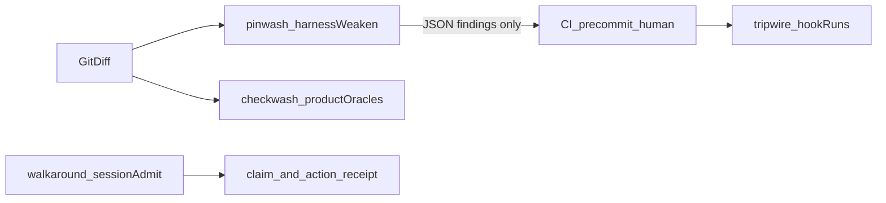
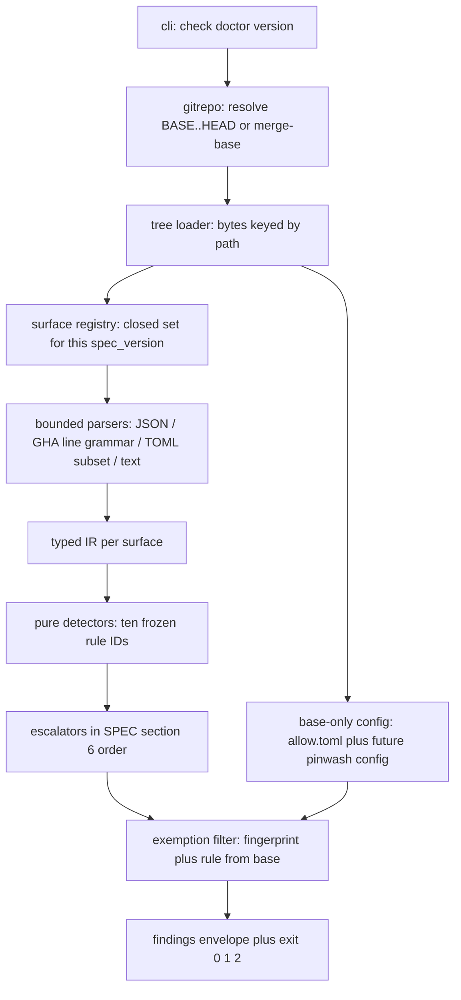
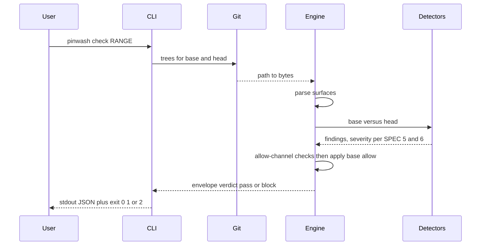

# pinwash architecture

**North star:** on a pair of git trees (`base` / `head`), using a closed surface set and a closed rule-ID set, flag harness weakenings that make an agent more able to claim done. The verdict is replayable: no network, no LLM, no subject execution.

This file explains layers and evolution. It does **not** add rules, surfaces, exit codes, or acceptance criteria.

**Conflict rule:** [SPEC.md](SPEC.md) wins. [THREATMODEL.md](THREATMODEL.md) owns residual rows. Frozen acceptance is [tests/gates/test_v0_acceptance.py](tests/gates/test_v0_acceptance.py). Coding agents have read-only authority over `tests/gates/**`. SPEC rulings and edits are delegated to the maintaining agent (SPEC preamble, 2026-09-27): each one bumps the spec version, lands as its own commit, and re-runs the fixture suite. If this file disagrees with SPEC, SPEC is correct and this file is wrong.

SPEC's opening records the local engine and the 2026-09-27 delegated edit authority. This checkout has a **local v0 engine** at `0.0.0` / spec `11` (each bump is its own commit with a changelog entry in SPEC §16). That is not a Release, not PyPI, and not a 1.0 claim.

## 0. What this product is allowed to be

pinwash is a static, local, deterministic **diff scanner**. It judges **harness weakening**, not product tests, not claims, not journeys, not whether a hook actually ran.

It never emits `SECURE`, `HARNESS_INTACT`, `HONEST`, `COMPLETE`, or `ENFORCED`. The strongest valid pass sentence is SPEC §0:

> No in-scope weakening finding at or above `fail_on` was observed on this base/head pair, under this spec version, surface set, and pinwash revision.

A1–A11 holding does **not** license a public 1.0 (SPEC §12).

## 1. Neighbours (do not reimplement)



| Product | Question pinwash does not answer |
|---|---|
| checkwash | Did this diff weaken product tests / CI oracles? |
| walkaround / action-receipt / claim-receipt-lab | Did the agent enter a contract or emit a receipt for a done-claim? |
| phaseledger | Did a measurer allow a phase advance? |
| charterlock | Was the journey allowed to be the exam? |
| tripwire | Is a hook actually executing a pinned judge on this host? |
| boundkit | Was the task claimed and authorized? |
| smallestlie | What lie does this verifier still accept? |

On one diff, checkwash may emit a guardrail-touch event and pinwash may emit a structured weakening. Identities must not be shared. A hook runner may **invoke** pinwash; enforcement belongs to that runner. pinwash does not install, invoke, or trust hooks.

Of the neighbour products in this diagram and table (pinwash itself aside), only checkwash and smallestlie remain on GitHub. walkaround, action-receipt, claim-receipt-lab, phaseledger, charterlock, tripwire, and boundkit were removed on 2026-09-26; they are named only to bound pinwash's scope, not as live integrations.

## 2. Trust boundaries (invariants)

1. The **head** tree — including the working tree — is attacker-controlled. Agents write it.
2. **Configuration and allowlists are read from the base side only.** A head-side disable does not govern the run that reviews that head. Creating a base-absent config that relaxes defaults is itself a finding (`CONFIG_RELAXED`).
3. The core path **reads bytes**. It never executes subject code, hooks, judges, workflows, MCP servers, or skills. It never uses a network. It never calls a model.
4. GitHub rulesets that exist only on an API and not as a file in the trees are residual R05: `UNKNOWN`, not pass and not block.
5. The analysis unit is a **diff** (`base`/`head`). pinwash never judges a single snapshot as “the harness is fine”.
6. Missing observation is never a pass: unobservable inputs surface as `SURFACE_UNPARSEABLE` findings, `config_errors` entries, or `unknown_coverage` rows. A crashed engine is exit **2**, never a block (exit 1). Subject-surface parse failure is `SURFACE_UNPARSEABLE`, not exit 2, unless git itself cannot be read.
7. Artifacts the agent wrote in the same diff (logs, screenshots, “CI is green” prose) are never evidence that a harness still runs.

The only clock that may affect a verdict is the exemption window on `.pinwash/allow.toml` (expiry, the spec 11 in-force start, and the spec 11 check for added records whose `created` is after today), overridable with `PINWASH_TODAY` for replay.

Range notation matches checkwash: `BASE..HEAD` is tree-to-tree; `BASE...HEAD` is `merge-base(BASE, HEAD)..HEAD` and must not silently become two-dot. Paths use forward slashes. Comparison text is CRLF→LF before parse.

## 3. Runtime layers

### 3.1 Target shape (1.0 module layout; the split landed in afec809)

Adding a surface must be: spec bump + one registry row + one parser + one detector. Not another loop in a thousand-line engine.



The module split landed in afec809 (behaviour-preserving, no spec bump):

- `pinwash/parse/` — `gha`, JSON surfaces, TOML subset, hook command strings
- `pinwash/rules/` — one module per rule family
- `pinwash/escalate.py` — `SEVERITY_RANK` and the SPEC §6.1–6.3 predicates
- `pinwash/allow.py` — base `.pinwash/allow.toml`
- `pinwash/engine.py` — orchestration only

Still short of this shape: the typed IR (§3.2), severity set where findings are emitted rather than in one escalator stage, and `allow.toml` in the surface `EXACT` set (§10).

Public JSON fields and the fingerprint formula stay frozen in SPEC §7. A refactor that changes fingerprint semantics is a spec bug.

### 3.2 What this checkout actually has

| Layer | Duty | Code today |
|---|---|---|
| CLI | Dispatch; unexpected exceptions → exit 2 | `pinwash/cli.py` |
| Git adapter | Two-dot / three-dot; tree bytes (blobs only: a gitlink is no file, b5c7551); a worktree file the engine cannot read counts as non-UTF-8 bytes (f849b8a); unreadable git → `GitError` | `pinwash/gitrepo.py` |
| Surface registry | Path → membership in the v0 closed set | `pinwash/surfaces.py` |
| Bounded parsers | Not YAML 1.2, not full TOML, JSON read the same at any depth and integer length (§5), closed hook-command resolution | `pinwash/parse/` (`gha`, `jsonsurf`, `tomlsub`, `hookcmd`) |
| Typed IR | Detectors must not see raw YAML | **Missing** — 1.0-shape gap |
| Detectors | Pure, no I/O; one module per rule family | `pinwash/rules/` |
| Escalators | SPEC §6 order; no scores | `pinwash/escalate.py` holds the SPEC §6.1–6.3 predicates; every other severity is set where its finding is emitted (§10) |
| Allow | Fingerprint + rule; never a rule-glob | `pinwash/allow.py` |
| Envelope | Stable sort keys; no clock; no floats | `pinwash/findings.py` |

`engine.py` is orchestration only: surface dispatch, the §3 unparseable table, and assembly.

## 4. Data flow



- `pinwash check` with no range: `HEAD` versus worktree. Worktree is the attack surface (tracked and untracked, `--exclude-standard`).
- Default `fail_on` is `high`. `warn` does not fail the run (A6: phrase hit on skill markdown is warn, exit 0). `PERMISSION_WIDENED` and `CONFIG_RELAXED` escalate to **high** (`CONFIG_RELAXED` at `.pinwash/allow.toml` is **critical**, SPEC §10); `EXEMPTION_ADDED` is **critical** when an added record's `created` is after today (spec 11). Last remaining Stop-like hook, last remaining required context, or last non-floating pin on a workflow (when floated) escalate per SPEC §6.
- stdout JSON is the **only machine API**: UTF-8, sorted keys, `ensure_ascii=False`, newline `\n`. Human reports may degrade glyphs; machine JSON may not. A lone surrogate in a value (a non-UTF-8 path name decoded with `surrogateescape`, a JSON `\udXXX` escape) is written as a `\udXXX` escape inside its string, which loads back to the same value, and is fingerprinted through `surrogatepass`; every other string encodes and hashes as before (0ddcd57). It used to crash to exit 2.
- `unknown_coverage` does not change `verdict`. A consumer that requires “no unknown coverage” is **consumer policy**, not this spec.
- `pinwash_findings_version` is `1`. `spec_version` tracks SPEC §16 (currently `11`). `pinwash_version` is `0.0.0`.

## 5. Surfaces, parsers, detectors (v0 closed set)

Adding a surface or a rule ID is a spec bump. v0 rule IDs (and no others in the `rule` field):

`HOOK_REMOVED` · `HOOK_BYPASSED` · `GATE_STUBBED` · `JUDGE_UNPINNED` · `PERMISSION_WIDENED` · `SKILL_BYPASS` · `REQUIRED_CHECK_DROPPED` · `CONFIG_RELAXED` · `EXEMPTION_ADDED` · `SURFACE_UNPARSEABLE`

Internal helper names must not appear in JSON `rule`.

| Surface ID | Paths | Parse | Detectors |
|---|---|---|---|
| `claude_settings` | `.claude/settings.json`, `.claude/settings.local.json` | JSON object | hook trio; `PERMISSION_WIDENED` |
| `claude_hooks` | `.claude/hooks/**` plus §3.3-resolved command targets (restored in spec 4) | JSON if `.json`, else command string | parse status; §5.2 closed-set body stubs feed `GATE_STUBBED` and the last-Stop escalator |
| `cursor_hooks` | `.cursor/hooks.json` | JSON object | hook trio |
| `cursor_mcp` | `.cursor/mcp.json`, `.mcp.json` | JSON object | `PERMISSION_WIDENED` |
| `agent_markdown` | `AGENTS.md`, `CLAUDE.md`, `GEMINI.md`, `QWEN.md`, `.cursorrules`, `.windsurfrules`, `.clinerules`, `.github/copilot-instructions.md`, `.cursor/rules/**/*.mdc`, `.cursor/rules/**/*.md` | UTF-8 text | `SKILL_BYPASS` only |
| `skill_md` | `**/SKILL.md` and the two skill trees named in SPEC §3 | UTF-8 text | `SKILL_BYPASS` only |
| `gha_workflow` | `.github/workflows/*.{yml,yaml}` | bounded line grammar, not YAML 1.2 | job drop / `if: false` / `continue-on-error` / `on:` trigger-loss (spec 8) — job side fires only for jobs producing a base-named ruleset context (SPEC §5) |
| `action_pin` | same workflow files | `uses:` lines in that grammar | `JUDGE_UNPINNED` |
| `gha_ruleset` | `.github/required-ruleset.json`, `.github/rulesets/*.json` | JSON object | `REQUIRED_CHECK_DROPPED` |
| `declared_pins` | `.pinwash/pins.json` (optional) | JSON array of pin records | `JUDGE_UNPINNED` |
| `checkwash_config` | `.checkwash/config.toml`, `.greenwash/config.toml` | bounded TOML subset | `CONFIG_RELAXED` |
| `gemini_settings` | `.gemini/settings.json` | JSON object | `PERMISSION_WIDENED` (`autoAccept`, `approvalMode`, mcp `trust`) |
| `opencode_config` | `opencode.json` | JSON object | `PERMISSION_WIDENED` (`permission.<tool>` lattice) |

Files outside these paths are invisible to v0. A harness that lives only in `$HOME`, a SaaS UI, or a gitignored local settings file is residual R02.

`.pinwash/allow.toml` is the **exemption channel**, not a §3 surface. Today `pinwash/surfaces.py` lists it in `EXACT` so the tree loader keeps the bytes. Architecturally it is config, not a detection surface. Head-side additions never govern the current run, which still trusts **base**; they surface as `EXEMPTION_ADDED` (critical when an added record's `created` is after today, SPEC §10).

`SKILL_BYPASS` compares **added or edited lines** (not deletions) against the closed phrase table in SPEC §5.4. Documentation of those phrases in `SPEC.md` / `THREATMODEL.md` / `README.md` is excluded by path. **This file is not in that exclude set.** Do not paste the phrase table here. Extra exclude globs are a spec bump. The exclusion covers phrase matching only: the SPEC §3 parse-status check runs first, so an excluded `agent_markdown` file such as `.cursor/rules/x/README.md` that stops decoding is still `SURFACE_UNPARSEABLE` (5794e5c).

If a surface file existed at base and is unparseable at head under that surface’s parse: `SURFACE_UNPARSEABLE` high. Unparseable on both sides: warn.

JSON surfaces parse the same at any nesting depth and any integer length (0ddcd57). A document nested up to 128 levels (a linear bracket pre-scan outside strings decides) goes to `json.loads` as before; a deeper one goes to an iterative reader of the same grammar, which tests hold to `json.loads` on generated and real documents. The hook and ruleset walkers keep their own stack. Before, `json.loads` raised `RecursionError` from about 990 levels on 3.11 (fewer under a deeper caller stack) and about 10000 on 3.12/3.13, the walkers recursed again over what did parse (a ruleset failed just below 1000 levels on every interpreter), and the CLI exited 2, so between those depths the interpreters disagreed. Integer literals up to 4300 digits (CPython's default `int_max_str_digits`) convert to the same `int` as before without consulting the process limit, so `PYTHONINTMAXSTRDIGITS` cannot change a result; a longer literal, which `json.loads` refused, is kept as an exact `decimal.Decimal` (no rule reads JSON numbers). Every document the engine judged before is judged the same, and the ones it crashed on are judged on all three interpreters. A JSON surface is `unparseable` only for a syntax error or bytes that are not UTF-8. Open for a ruling (§10): SPEC §3's table emits nothing for a surface absent at base and unparseable at head, while §3.2 says a checkwash config that is not UTF-8 is `SURFACE_UNPARSEABLE` with no base-side condition.

### 5.1 Bounded GHA grammar (v0)

After CRLF→LF: drop comment lines; spaces-only indent (the engine fails the file on a tab anywhere before a line's first `#`, wider than SPEC §3.1's indentation wording; §10); record `uses:`, `continue-on-error:`, `if:`, job keys (exactly two spaces under `jobs:`), and job `name:` under the stack in SPEC §3.1, plus (spec 8) the triggers of a column-0 `on:`: inline scalar, inline `[a, b]`, and indent-2 block list items or mapping keys. Every recorded value is truncated at the first ` #` (spec 5).

Residuals, not findings, not passes: YAML aliases, multiline scalars, `uses` split across lines, `true` written as `yes`, jobs generated by reusable workflows, `workflow_call` indirection, and an `on:` block the grammar cannot resolve (spec 8). Those are `unknown_coverage`, reported from either side once per (path, reason). #4 (c11e958) routed values outside the closed forms there without a bump: a block-scalar header or empty remainder on `uses`, `continue-on-error`, `if` or job `name`; `continue-on-error` other than `true` / `false`; a block-scalar `on:`. `docker://` uses has been unknown since spec 0. A quoted `"on":` / `'on':` key is an unresolved `on:` block whose triggers are not read (8af4d6f). A head `on:` block unresolved wholly or in part is never an observed trigger removal; at base only the triggers the grammar resolved count, because an unresolved base item can only add triggers (a quoted base key resolves none). At head this routes two trigger losses that `c71c468` blocked to an `unknown_coverage` row alone: a quoted `"on":` key, and an indentless flow-map item such as `  - {cron: …}` under `schedule:` beside resolved triggers. `on: {workflow_dispatch: {}}` already took that route; reading these forms widens the grammar (§10). The engine must not invent “no `uses` change” from an unparsed construct.

Outside the grammar with no residual row (§10): quoted keys other than `on` (`"jobs":`, `"uses":`) and jobs indented other than two spaces. The jobs or pins behind them are not seen, and no `unknown_coverage` row says so.

### 5.2 Pin identity

A pin is `{locator, kind, value, product?}` as in SPEC §4. Locator examples must stay stable across reformatting.

Kind lattice, stronger to weaker:

```
digest_sha256 > git_sha (full 40 hex) > git_tag > action_ref-that-is-tag > floating
```

`JUDGE_UNPINNED` is kind moved down the lattice; value changed to floating; pin removed while the consumer still exists; digest present at base and absent at head; SHA shortened below 40 hex.

Tightening (tag → sha, sha + digest added) is not a finding. Vendor-directory **content** edits without a pin-record change are residual R04 in v0.

`.pinwash/pins.json` is optional. Head-only creation is not a finding. If present at base, every record must keep kind/value or a documented allow fingerprint (SPEC §4 text; the engine follows the unpin list, §10).

Fingerprint (exemption key): `rule/path/v1:` plus hex sha256 of canonical JSON `{rule, path, locator, before_digest, after_digest}`. Allow entries are per fingerprint, never per-rule-glob; all six keys required; `expires` at most 180 days after `created` and not before today to be valid (visible to the add/edit/delete checks), and at most 180 days after the earlier of `created` and today to be in force, with no other valid record for the same fingerprint and rule whose `created` is after today (spec 11). Allow-channel findings at `.pinwash/allow.toml` are never exempted (spec 11).

## 6. Exit codes and determinism

| Exit | Meaning |
|---|---|
| 0 | No finding at or above `fail_on`; engine finished |
| 1 | Verdict `block` |
| 2 | Engine error, including unexpected exceptions and unreadable git trees |

No floats in the verdict path. No network. No clock in findings JSON (exemption date is the exception above). No random. Zero runtime dependencies. SPEC §9 requires JSON bytes identical on Windows / macOS / Linux for the same trees and Python 3.11–3.13. A10 checks less: LF versus CRLF subject files, one interpreter, one host. A local Linux run on `f849b8a` compared stdout bytes and exit codes across CPython 3.11, 3.12 and 3.13 with two hash seeds (README status row). Not CI-verified; Windows and macOS untested. Subject bytes no longer pick an interpreter- or host-dependent path: a deep JSON document is read iteratively and judged on all three, where 3.11 exited 2 and 3.12/3.13 judged it, and `PYTHONINTMAXSTRDIGITS` no longer moves a long integer between judged and exit 2 (0ddcd57).

## 7. Consumers (outside the core)

pinwash may be **wrapped** by a hook or a CI job. It remains not an enforcer. Job failure on exit 1 is **repository policy**.

| Consumer | How | What it is not |
|---|---|---|
| Local / pre-commit | `python -m pinwash check` or `HEAD~1..HEAD` | Proof the remaining harness works |
| PR CI | Runner already has two trees; run `BASE...HEAD` | pinwash executing a GitHub required check |
| Stop hook runner | May shell out to pinwash | Closing residual R01 (a host CLI that never consults repo hooks) |

Forbidden consumer fantasies:

- Call a GitHub ruleset API to close R05.
- Call a model to close R08.
- Auto-fix the diff (another product).
- Treat `unknown_coverage` as pass.

`doctor` (SPEC §13): own tests **and** spec hash; must not judge the subject (`subject_judged: false`). It runs this package's unittest suite in-process under a `PINWASH_DOCTOR_SELFTEST` guard (the gate suite spawns `pinwash doctor`, so the guard stops a doctor running inside its own test run from recursing); own-test failure is exit 2.

## 8. v0 held versus 1.0 license

**Held locally, informal:** `python -m pinwash check`; A1–A11 in stdlib unittest; no network; exit 0/1/2. `python -m pinwash --version` prints `pinwash 0.0.0 spec 11`: `spec_version` follows SPEC §16 (spec bumps are delegated per SPEC's preamble); the engine version stays `0.0.0` until a human bumps it.

**1.0 license (every item is a human decision; missing one forbids saying 1.0):**

1. ~~Human edits SPEC's "No engine exists yet"~~ Held: updated in spec 3 under the 2026-09-27 delegation (own commit; A11's original constraint — the first satisfying engine PR did not touch SPEC — still holds historically).
2. ~~Prefer `spec_version >= 1` over a footnote "spec 0 + engine 1.0"~~ Held: `spec_version` is `11` (SPEC §16).
3. THREATMODEL R01–R10: each row is **Closed** with a named fixture, or **Permanent** with a human signature that it will not be closed and will not be pretended closed. Closed without a fixture fails the suite.
4. Findings envelope and fingerprint stay backward compatible (`pinwash_findings_version: 1` already).
5. `doctor` actually runs this package’s tests. (Held in v0 as of this change set; the item stays on the list as a 1.0 check.)
6. At least one consumer recipe that quotes the pass sentence plus spec version plus pinwash revision.
7. A10-class determinism still holds (SPEC §9; §6 says what has been checked so far).
8. Public language follows SPEC §14.

**Still forbidden on the core path at 1.0:** live GitHub / Cursor APIs, LLM classification of skills, a full YAML 1.2 parser, replacing checkwash, auto-fix, treating UNKNOWN as pass.

## 9. Spec-bump candidates (not 1.0 tickets)

Each is its own SPEC change plus fixture re-run. Detectors must not be patched to fit a fixture. Fixtures that are out of spec stay residuals.

1. ~~**R07 (highest-value hole):** bounded scan of hook **file bodies** pointed at by repo-relative commands, bundled with command-target resolution~~ **Done in spec 4** (closed §3.3 resolution rule, closed §5.2 body stub sets, body-aware last-Stop escalator). R07 stays Open for stub shapes outside the closed lists and opaque command forms — a further widening is its own bump.
2. **R06:** new agent hosts as new surface tables. Wave 1 done in spec 6, in one bump: `gemini_settings`, `opencode_config`, and the Gemini / Qwen / Copilot / Windsurf / Cline instruction files in `agent_markdown`. R06 stays Open for the hosts and shapes its SPEC §11 row names; each further wave is its own bump.
3. **R03:** widen the **bounded** GHA grammar (still not YAML 1.2). Widened in spec 5 (inline ` #` comment truncation, found by live-fire on taipei49314/checkwash) and spec 8 (closed `on:` trigger forms, found in live-fire round 2). Without a bump, #4 (c11e958) and the quoted-`on:` fix (8af4d6f) route values outside the closed forms to `unknown_coverage` (§5.1). Multiline `uses` becomes decidable only after the grammar actually covers it.
4. **R04:** if `pins.json` declares a digest, a vendored-judge byte change may become `JUDGE_UNPINNED`; undeclared content edits stay residual.
5. **R08:** extra exclude globs or a narrower phrase table — still no model.
6. Optional: base-only `.pinwash/config.toml` for pinwash’s own `fail_on`, distinct from the subject’s checkwash config.

Default **Permanent** at 1.0 unless a human closes them with fixtures: R01 (host CLI ignores repo hooks), R02 (harness only in home / SaaS / gitignored local), R05 (live ruleset not in trees), R09 (required-check rename with no ruleset file), R10 (pinwash not run).

## 10. Debt against this architecture (honest, not a silent SPEC patch)

- ~~SPEC and THREATMODEL still describe an unshipped engine.~~ Held in spec 3 / this change set: SPEC's preamble and THREATMODEL's header now record the local engine; A11's original constraint (the first satisfying engine PR did not touch SPEC) still holds historically.
- The engine may emit `EXEMPTION_ADDED` for head-side allow.toml appends. SPEC §5 says no other v0 rule IDs. Before 1.0 a human must either add it to §5 or demote it to `unknown_coverage` / `config_errors` visibility so it is not a `rule`. (SPEC §10 does name `EXEMPTION_ADDED`; the two sections need one human ruling.) → **Ruled 2026-09-27 (delegated): `EXEMPTION_ADDED` is a §5 rule as of spec 1**, and §10 validity now defines which allow.toml records count on both the addition and the edit/delete checks (implemented with verbatim record comparison, so a same-fingerprint edit is critical).
- SPEC §1.6 called a missing observation `INCOMPLETE`, but the §7 severity enum has no such value. → **Ruled 2026-09-27 (delegated): the token is removed as of spec 2.** The fail-closed invariant stays and is carried by the three existing channels; no detector or envelope change.
- SPEC gave `REQUIRED_CHECK_DROPPED` no per-rule severity carve-out, so every producer-side shape (deleted job, `if` disable, `continue-on-error`, trigger-loss) landed at `warn` — below the default `fail_on=high`, leaving a required check that can never gate again with a passing verdict. Round 3 (opencode zen bench, `pinwash-live/round3`) produced the live specimen (`# on: push`, warn, verdict pass). → **Ruled 2026-09-28 (delegated): producer-side `REQUIRED_CHECK_DROPPED` bases at `high` as of spec 9** (§5 preamble exception, §6.5); ruleset-side drops unchanged (`warn`, `critical` per §6.2).
- Fidelity fixes in this change set (engine side only; SPEC untouched): `SURFACE_UNPARSEABLE` now follows the §3 closed table on every surface including `.claude/hooks/**` and `.pinwash/pins.json`; a deleted or unparseable head `allow.toml` with base exemptions is `CONFIG_RELAXED` critical; job-side `REQUIRED_CHECK_DROPPED` is ruleset-linked per §5; declared `action_ref` pins rank per the §4 lattice; a commented-out hook command is the v0 closed shape of "command prefixed with a no-op" (`HOOK_BYPASSED`, and non-live for the last-Stop escalator); a corrupt (unparseable) baseline no longer produces invented findings on `cursor_mcp` / `claude_settings` permissions. An absent baseline still compares as empty: a created `.mcp.json` with a server not marked `disabled: true`, or a created settings file granting `Bash(*)`, is `PERMISSION_WIDENED` high.
- ~~Still open: hook `command` strings that resolve to repo-relative files...~~ **Resolved in spec 4:** §3.3 restores target resolution with a closed tokenizer rule, and §5.2 body stubs wire into `GATE_STUBBED` and the last-Stop escalator.
- `HOOK_BYPASSED` judged skip flags on a per-event aggregate while SPEC §5 speaks of an existing hook, and §5.1 omitted `hookEnabled` and scoped `disabled` to Cursor. → **Ruled 2026-10-01 (delegated): spec 10** — §5.1 is the exact key table on both hook surfaces and flags are command-local (pinwash#5, #6).
- A base allow.toml record could exempt the exemption channel's own constant-fingerprint findings (`CONFIG_RELAXED`, `EXEMPTION_ADDED`), and the 180-day cap ran from a self-declared `created`, so a future date kept a record in force for as long as that date allowed (to 9999-06-30 in #17's example). → **Ruled 2026-10-01 (maintainer, pinwash#17): S1 and S2 are bugs against §10.** Design (delegated), **spec 11**: `apply_allow` never drops findings at `.pinwash/allow.toml`; an exemption is in force only while `expires` is at most 180 days after `min(created, today)`; validity for the visibility checks is unchanged; adding a record whose `created` is after today is `EXEMPTION_ADDED` critical, and a record is not in force while another for the same fingerprint and rule has its `created` after today, because per-record windows could otherwise be chained. Issue #17's A12, S3 and S4 keep the classification #17 gave them.
- Fidelity fixes, 2026-10 (engine only; SPEC untouched; no bump). Subject bytes that crashed the engine to exit 2 are judged instead (0ddcd57): JSON nested at any depth (an iterative reader past 128 levels and iterative walkers, with no depth bound, so nothing the engine judged before changes) and integer literals of any length, read the same under any `int_max_str_digits` (§5); lone surrogates in fingerprints and stdout (§4); a non-string gemini `approvalMode`, now an unknown value as SPEC §5.3 says; and a checkwash `fail_on` value that matched only through the case folding of U+0130 / U+0131, now outside the §3.2 subset. A quoted `on:` key is unresolved, and a head `on:` block unresolved in whole or in part is no observed trigger removal, while a base block's resolved triggers still count (8af4d6f, §5.1). The SPEC §3 parse-status check runs before the SPEC §5.4 exclusion (5794e5c, §5). `CONFIG_RELAXED` compares the effective `fail_on` of an edited config: a head without a `fail_on` line runs on the default `high`, so removing a stricter line fires like the explicit edit, and a head `fail_on` line the §3.2 subset does not read (inline comment, BOM, multi-line, quoted or dotted key, unknown value) is not taken for the default (7004ccc). `claude_settings` `PERMISSION_WIDENED` controls pinned, no engine change (760cfbf). A gitlink (submodule) entry is skipped instead of exiting 2 (b5c7551), and a worktree file the engine cannot read counts as non-UTF-8 bytes, so a surface is `SURFACE_UNPARSEABLE` and any other path is ignored, instead of exiting 2 (f849b8a). Open from that change set, for a ruling, and pinned by no test: (a) a surface absent at base and unparseable at head (#22) (a JSON syntax error, bytes that are not UTF-8) emits nothing under SPEC §3's table, while §3.2 says a checkwash config that is not UTF-8 is `SURFACE_UNPARSEABLE` with no base-side condition; (b) deleting a checkwash config that set a stricter `fail_on` is silent: SPEC §5 names base-absent and edited configs, not deleted ones, and firing per path would also block a `.greenwash/config.toml` → `.checkwash/config.toml` rename, or removing a legacy file while the other path keeps the stricter value, because SPEC states no precedence between the two paths; (c) the SPEC §5.4 exclusion matches the three file names by basename anywhere, where SPEC says "by path"; (d) at head, a quoted `"on":` key or an indentless flow-map trigger item turns a trigger loss into an `unknown_coverage` row (§5.1), as SPEC §3.1 says, where `c71c468` blocked; reading those forms widens the grammar. Pre-existing, seen in the same review: `SKILL_BYPASS` aligns lines with `difflib.SequenceMatcher(autojunk=False)`, quadratic on repetitive text (an `AGENTS.md` edit of 16000 short lines took about 14 s on 3.12, four times the 8000-line time); a faster alignment changes which lines count as added, so it waits for a ruling on what an added line is.
- No typed IR: detectors still speak raw dicts and a callback `add`. Severity is spread across detectors: `escalate.py` holds `SEVERITY_RANK` and the SPEC §6.1–6.3 predicates; the SPEC §5 base severities and the §6.4 / §6.5 / §10 severities are set where each finding is emitted (`engine.py` for `SURFACE_UNPARSEABLE`; `rules/required_check.py`, `rules/permission.py`, `rules/config_rule.py` and the declared-pin branch of `rules/pin_rules.py` at `high`; `allow.py` at `critical`).
- Open issues #9–#18 are unruled debt (#17's S1 / S2 were ruled in spec 11, above). Each issue classes its members as SPEC holes or residuals with no row; this file does not pre-judge them. The maintainer's direction for them (2026-10-09) is to book first, in one bump of residual rows and `unknown_coverage` routing, and detect later, one family per bump; #22–#26 track what the 2026-10 review found beyond them.
- SPEC/engine divergences awaiting a ruling (checklist in #26, except the last two items). Each can close with an engine change that follows the SPEC text (no bump) or with a SPEC change (a bump); the choice is the maintainer's, and neither is changed here. Each item is tagged with how engine and text differ:
  - *Engine beyond SPEC text.* §6.3 escalates only a pin moved to floating. The engine also makes a removed workflow `uses:` pin high (critical when no non-floating pin is left) and a removed, digest-losing or kind-weakened declared pin high.
  - *SPEC text inconsistent.* §5.3 `opencode_config` row says "becomes `allow`"; the lattice sentence and the engine fire on any downward move (`deny` → `ask` is high).
  - *SPEC text ambiguous.* §5.3 `cursor_mcp` row ("`disabled: false` added") is ambiguous. The engine fires on any added server not marked `disabled: true`, a created file included, and on `true` → `false`; deleting `"disabled": true` is silent.
  - *Engine beyond SPEC text.* §7's field table has no `locator`; the engine emits it when non-empty.
  - *SPEC example incomplete.* §4's locator example lacks the `#<n>` occurrence suffix the engine emits (`uses:<repo>#<n>`).
  - *Engine beyond SPEC text.* §6.1 names the Cursor stop / finish hook; the engine's Cursor stop-like set also holds `afterAgentResponse`.
  - *Engine short of SPEC text.* §4 says every base `pins.json` record "must keep kind/value"; the engine follows the unpin list, so a same-kind change to a non-floating value (`git_tag` `v1.0.0` → `v0.1.0`) is silent.
  - *SPEC text wrong.* The §16 rows for spec 5 and 6 cite "§9.3" / "§9.2", meaning items 3 and 2 of this file's §9; SPEC §9 has no subsections.
  - *Engine short of SPEC text.* §2 defines spans; no span field exists in §7 or the engine.
  - *Engine beyond SPEC text.* §3.1 ties the tab rule to indentation; the engine fails the file on any tab before a line's first `#` (#25).
  - *SPEC text incomplete.* Quoted YAML keys other than `on`, and jobs indented other than two spaces (four, say), are outside the grammar with no residual row (§5.1 above; #23, #24).
- ~~`gitrepo.ls_tree` calls `git show` per blob (N+1).~~ Fixed: one `cat-file --batch` round trip per tree; the analysis unit is unchanged.
- `.pinwash/allow.toml` is mixed into the surface `EXACT` set.

## 11. Non-goals that stay non-goals

SPEC §15 for spec 0, and the core-path ban in §8 of this file for any later 1.0:

- Enforcing hooks (tripwire).
- AST parsing of Python/JS hook bodies (SPEC §15, R07). The bounded SPEC §5.2 body scan (closed line lists since spec 4, the `block` / `deny` substring shape since spec 7) reads bytes and is not this.
- LLM classification of skills.
- Live GitHub / Cursor API reads.
- Replacing checkwash CI/test rules.
- Auto-fixing the diff.
